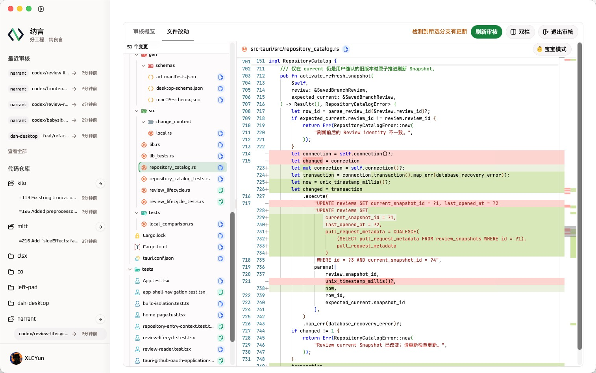
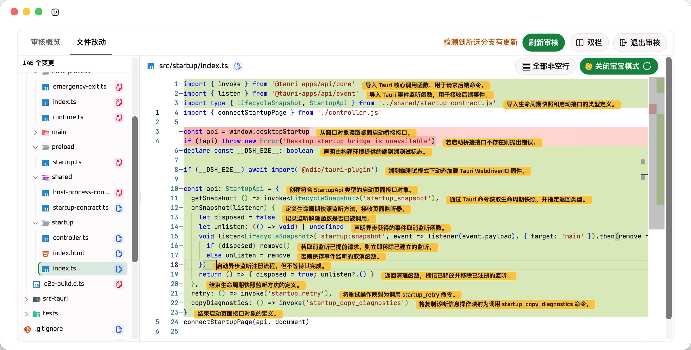

  
  <h1>纳言 Narrant</h1>
  
<strong>好工程，纳良言</strong>

  
代码审核不应成为 AI 瓶颈，让 AI 加速人类审核，与 AI 协作守住最后一关。

  
<a href="./README.en.md">English</a> · <a href="#宝宝模式">宝宝模式</a> · <a href="#下载">下载</a> · <a href="#使用说明">使用说明</a> · <a href="#主要功能">主要功能</a> · <a href="#反馈问题">反馈问题</a>

## 项目简介

AI Coding 正在加快代码产出，也让待审核的改动变得更多、更频繁。对于重要的代码，人类审核仍是合入主分支前的最后一道护城河。审核者要理解改动是否符合真实需求，并为架构取舍和潜在风险做出判断。

Narrant 是一款让 AI 加速人类审核的桌面工具。它统一呈现本地分支与 GitHub Pull Request，通过清晰的 Diff 和 AI 辅助解释，帮开发者更快看懂改动，同时把最终判断留给工程师。

## 👶 宝宝模式

宝宝模式会调用本机已登录的 Codex，为当前代码变更生成逐行解释。你可以只看发生变化的行，也可以展开全部非空行，对照变更前后的代码理解每一行在做什么。遇到陌生语言、复杂逻辑或较大的改动时，它可以先替你梳理细节，减少来回查找上下文的时间。

这些解释用于辅助阅读，不会替你批准改动或给出最终审核结论。二进制文件、依赖文件、构建产物、lock 文件和其他不适合逐行分析的内容会被跳过。使用前请安装 Codex CLI 并完成登录，开启宝宝模式后，当前文件的变更内容会交给 Codex 分析。

## ⬇️ 下载

前往 [GitHub Releases](https://github.com/XLCYun/narrant/releases) 下载最新版本，并选择与你的操作系统和处理器架构相符的安装包。

## 使用说明

1. 打开 Narrant，选择一个本地 Git 仓库。
2. 阅读工作区信任提示，确认后进入仓库。
3. 在“本地分支”中选择 Head 与 Base，或从“Pull Requests”中选择要审核的 PR。
4. 在审核概览和文件改动之间切换，逐个阅读变更。
5. 需要辅助理解时，在支持的代码文件中开启宝宝模式。
6. 检测到新的提交后，按需刷新审核快照。

如果要查看私有 Pull Request，请先在应用中连接 GitHub，并为目标仓库授予读取权限。

## ✨ 主要功能

- **审核本地分支**。选择 Base 与 Head 分支，按实际合入方向查看完整变更
- **发现 GitHub Pull Request**。从本地仓库的 GitHub remotes 发现公开 PR，连接 GitHub 后也可访问已授权的私有仓库
- **专注阅读代码**。以文件树浏览新增、修改、删除和重命名文件，并在单栏或双栏 Diff 间切换
- **保留审核历史**。按仓库保存 Review 与快照，分支或 PR 更新后可显式刷新并继续审核
- **中英文界面**。根据系统语言自动选择，也可在应用内切换
- **明暗主题**。跟随系统外观显示

## 🔒 本地优先与安全边界

Narrant 直接读取你选择的本地 Git 仓库，并为审核创建由应用管理、退出时清理的临时工作区。开始使用某个仓库前，应用会要求你确认工作区信任，因为 Git hooks、filters 和 Git LFS 等仓库配置可能执行程序或读取外部内容。

连接 GitHub 是可选的。公开 Pull Request 可以匿名发现；访问私有仓库时，Narrant 通过 GitHub 的设备授权流程获取你明确授予的读取权限，并把凭据存放在操作系统凭据存储中。

## 当前状态

Narrant 仍在持续开发，界面、数据格式和功能行为可能在后续版本中调整。发布说明会列出每个版本的重要变化和已知限制。

## 反馈问题

欢迎通过 [GitHub Issues](https://github.com/XLCYun/narrant/issues) 报告问题或提出建议。提交问题时，请尽量附上操作系统、Narrant 版本、复现步骤和已经脱敏的错误信息；请勿上传访问令牌、私有代码或其他敏感数据。

## 开发与许可证

开发说明见 [开发文档](docs/development.md)。项目采用 [Apache-2.0](LICENSE)；第三方组件与素材保留各自的许可声明。

新的 GitHub Releases 下载渠道正在迁移，首个版本发布前下载列表可能为空。旧版本用户需要从本仓库手动安装一次修复版，之后使用新的更新渠道。
