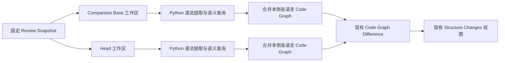

# Python Structure Changes 支持方案调研

调研日期：2026-09-29。仓库基线：`fc828a809110b07b2d8617c1e58b6e7051841956`。
本文保留 `grill-with-docs` 访谈的事实、候选比较和有限实测；实现以已接受的规格为准。
用户已确认 Q1–Q7，范围、对象粒度与技术决定记录在 [Python 规格](../specs/0023-python-language-analyzer.md)
和 [ADR-0033](../adr/0033-bound-python-analysis-to-repository-and-standard-library.md)；
设计访谈已完成；后续实施票及验证门槛由规格统一列出。

## 已接受的路线

沿用现有的「本地语法提取与内容规范化 + 固定语义服务」结构，新增 Python
`LanguageAnalyzer`，复用 Code Graph、差异计算、Review Workspace 生命周期和语言支持包。
语法层采用 Ruff parser；语义层采用固定 ty，保留 Pyright 作为对照与备选。
ty 的原生二进制、禁止外部命令的初始化选项，以及本轮样例中的源码导航结果值得优先推进；
受控配置组合已通过第二轮有限样例验证，真实路径边界仍需接入层处理；选型已经确认，
但不能只凭 LSP 支持列表宣称接入完成。
本轮也发现 ty 在未知条件下选择同签名函数时只导航到其中一个函数，因此这不是准确率排名。

用户已确认首版覆盖普通 `.py` / `.pyi` 源码，分析上下文限于仓库源码和固定标准库类型声明；
Notebook、用户虚拟环境和已安装第三方依赖不进入首版。

实现难点集中在 Python 对象的内容归属、源声明与调用目标的对应、可复现的项目环境，
并不在于给通用图再增加一套 Python 类别。

## 已有架构与继承约束

用户所说的「结构分析」对应领域词汇中的 **Structure Changes**：展示固定
**Review Snapshot** 的 **Code Graph Difference**。它目前不是整个仓库的架构地图。

| 已有事实 | 对 Python 的影响 | 依据 |
| --- | --- | --- |
| 输出图只包含此次 Change Comparison 的改动文件；两侧独立选取存在的路径 | 其他仓库文件可用于解析，但其对象不自动进入图 | [application::scope](../../src-tauri/src/structure_review/application/mod.rs#L492) |
| Rust 使用本地语法库 + rust-analyzer；TS/JS 使用 Oxc + TLS/tsserver | 语法负责完整对象/内容，语义服务提供目标证据，是已有接入形态 | [Rust adapter](../../src-tauri/src/structure_review/rust_analyzer/mod.rs#L84)、[TS adapter](../../src-tauri/src/structure_review/typescript_analyzer/mod.rs#L85) |
| 六个通用类别，字符串 LanguageId，语言专属 native_kind / extensions / semantic | Python 可保留自身构造，无需扩大通用 enum | [对象模型](../specs/0018a-code-object-kinds.md)、[ADR-0030](../adr/0030-use-extensible-code-object-kinds.md) |
| Node、External、Unresolved 各有明确含义 | 未选中的仓库源码也是 External；未知动态目标不能伪装成 External | [关系模型](../specs/0018b-code-relationships.md) |
| 自身内容、直接成员集合和引用集合分别比较；集合忽略顺序 | Python 的执行次序必须保留在可比较内容中 | [diff.rs](../../src-tauri/src/structure_review/code_graph/diff.rs#L73) |
| 一侧的所有语言共享同一个 Git 工作区；复用 head，只额外准备 before | 不能另复制 Python 源码/配置树，也不能假定开发目录的 `.venv` 会出现在 Review Workspace | [ADR-0031](../adr/0031-reuse-review-head-for-structure-analysis.md) |
| 已支持语言的硬失败使整个比较失败，且等待取消和子进程清理 | 服务失败、解析失败不能以成功空图或缺关系掩盖 | [analyze_side](../../src-tauri/src/structure_review/application/mod.rs#L376) |
| 语言支持包固定为当前应用验证过的版本，与项目工具链分开 | Python 也应按需准备固定工具，而非分析时追逐 latest 或安装项目依赖 | [ADR-0032](../adr/0032-separate-language-support-packs-from-project-toolchains.md) |
| 当前 UI 隐藏 External 和 Unresolved，包括连线、计数和详情 | Python 动态关系多时，可见连线较少；成功分析不代表运行时调用关系完整 | [graph-presentation.ts](../../src/structure-review/graph-presentation.ts#L56) |

新增 Python 仍应保持跨 checkout 稳定身份、同一侧一致源码、原文展示、测试默认排除、
取消/超时/进程回收，以及语言图合并后的完整校验。既有决定无需重新提问。



## 语法解析器候选

语法解析器要提供声明、表达式、源码范围与错误信息；它本身不等于跨文件调用分析。
具体版本是本轮核查点，不代表应用已决定采用最新版本。

| 候选 | 与本项目相关的取舍 | 初步判断 |
| --- | --- | --- |
| Ruff parser `0.0.15` / Ruff `0.16.9` | Rust typed AST、tokens 和同生态 codegen；固定源码的正式目标到 Python 3.14，预览到 3.15。Rust API 不保证稳定，MSRV 1.96 | 优先做语法提取原型，精确锁定同批 crates |
| tree-sitter-python `0.25.0` | Rust/CST 接入方便，有错误恢复；但 PEP 696 类型参数默认值仍有已报告的解析缺口，规范化与版本验证需要自行处理 | 成立的备选，不能宣称完整支持 Python 3.13/3.14 |
| RustPython parser `0.4.0` | 官方独立 parser 已指向 Ruff；不能用 RustPython 解释器的新版本推断旧 parser crate 的语法覆盖 | 不作为新适配器的默认起点 |
| CPython 3.14 `ast` | 支持该版本 AST，包括 type parameters 和 TemplateStr；实际解析版本与分发绑定解释器，原文/注释需另外处理 | 可作一致性测试参考，暂不增加语法层 Python runtime |
| LibCST `1.9.0` | release 已支持 Python 3.15；原生 Rust `rlib` 可关闭 `py` feature，保留格式/注释，但错误恢复与 Python metadata 能力不能直接假定可用 | 偏向源码修改；本任务需要规范化去除 trivia，暂不优先 |

来源：[Ruff parser 固定 README](https://github.com/astral-sh/ruff/blob/0.16.9/crates/ruff_python_parser/README.md)、
[Ruff PythonVersion](https://github.com/astral-sh/ruff/blob/0.16.9/crates/ruff_python_ast/src/python_version.rs)、
[Ruff crate 版本政策](https://docs.astral.sh/ruff/versioning/#crate-versioning)、
[tree-sitter-python 0.25.0](https://github.com/tree-sitter/tree-sitter-python/releases/tag/v0.25.0)、
[PEP 696 缺口 #346](https://github.com/tree-sitter/tree-sitter-python/issues/346)、
[RustPython parser](https://github.com/RustPython/Parser)、
[CPython 3.14 ast](https://docs.python.org/3.14/library/ast.html)、
[LibCST 1.9.0 release](https://github.com/Instagram/LibCST/releases/tag/v1.9.0)、
[LibCST Rust 配置](https://github.com/Instagram/LibCST/blob/v1.9.0/native/libcst/Cargo.toml)。

Ruff 原型还需验证三个具体接口边界：显式设置目标 Python 版本，同时处理普通解析错误与
`unsupported_syntax_errors()`（仅检查 `into_result()` 不够）；对 `.pyi` 使用 Stub 模式；
把 `TextSize` 的 UTF-8 字节范围经同一份原文转换为 LSP UTF-16 坐标。上述解析器本轮均未做
Rust 可执行解析测试，语法覆盖结论来自固定源码与官方记录。
[Ruff parser API](https://github.com/astral-sh/ruff/blob/0.16.9/crates/ruff_python_parser/src/lib.rs)、
[ParseOptions](https://github.com/astral-sh/ruff/blob/0.16.9/crates/ruff_python_parser/src/parser/options.rs)、
[PySourceType](https://github.com/astral-sh/ruff/blob/0.16.9/crates/ruff_python_ast/src/lib.rs)、
[TextSize](https://github.com/astral-sh/ruff/blob/0.16.9/crates/ruff_text_size/src/size.rs)。

规范化必须保留有意义的缩进结构、字符串和 f-string 内容、定义时表达式与声明顺序。
原始 `source` 用于展示，规范 `signature` / `code` 用于比较，不应把去注释、删空白的正则
当作 Python 规范化器。Python docstring 是可观察的对象文档属性，不能默认按普通注释删除。
[Python 函数数据模型](https://docs.python.org/3/reference/datamodel.html#user-defined-functions)。

本机 `rustc` / `cargo` 均为 1.97.1，仓库没有 `rust-toolchain` 或显式 `rust-version`，
CI/release 使用 stable，当前没有已知的 1.96 版本门槛阻碍。这只是工具链事实核查，
尚未进行 Ruff 依赖解析或编译验证。
[Ruff 固定 Cargo 清单](https://github.com/astral-sh/ruff/blob/0.16.9/Cargo.toml)、
[应用 Cargo 清单](../../src-tauri/Cargo.toml)、
[CI 工具链配置](../../.github/workflows/quality-gate.yml)。

## 语义引擎候选与环境边界

Pyright 和 ty 都提供所需的源码导航能力，最终选择还要看目标返回质量、项目上下文控制、
工具分发和维护成本。`documentSymbol` 能返回大纲，但不能单独满足 Narrant 的
own-content、执行区域与引用证据需求。

| 候选 / 核查版本 | 导航能力 | 运行与取舍 |
| --- | --- | --- |
| ty `0.0.84` | documentSymbol、definition、references、typeDefinition、incoming/outgoing call hierarchy 均已实现 | 原生 Rust 二进制、MIT；独立 Python 支持包不必携带 Node；版本仍需严格固定 |
| Pyright `1.1.414` | 上述能力均实现 | Node、MIT；内部 Host / FileSystem 有较直接的定制入口，但不是稳定公开 API |
| basedpyright `1.40.1` | 上述能力均实现 | 仍以 Node 运行；PyPI 分发携带 Node 不等于无需 Node；当前需求未发现足以优先于前两者的额外收益 |
| python-lsp-server `1.14.0` + Jedi | 上述导航能力中前四项已实现，标准实现缺少 call hierarchy | Python runtime 与插件依赖更多；该版要求 Jedi <0.20，不能直接算入最新 Jedi 的能力 |

来源：[ty 固定请求实现](https://github.com/astral-sh/ruff/tree/11aaa39f84c0c44bdfb4c9cc21e4038c6f74c00a/crates/ty_server/src/server/api/requests)、
[Pyright 注册](https://github.com/microsoft/pyright/blob/1.1.414/packages/pyright-internal/src/languageServerBase.ts)、
[basedpyright 注册](https://github.com/DetachHead/basedpyright/blob/v1.40.1/packages/pyright-internal/src/languageServerBase.ts)、
[pylsp capabilities](https://github.com/python-lsp/python-lsp-server/blob/v1.14.0/pylsp/python_lsp.py#L278)、
[pylsp 依赖](https://github.com/python-lsp/python-lsp-server/blob/v1.14.0/pyproject.toml)。
ty 0.0.84 对应的实现固定在 Ruff commit `11aaa39f84c0c44bdfb4c9cc21e4038c6f74c00a`。

**Pyright 的边界：** 默认 `FullAccessHost` 会启动 Python 探测搜索路径；仅指定
`pythonVersion` 不会禁止探测。内部 `NoAccessHost` 可以不给 Python 路径并拒绝执行脚本，
配合受限 FileSystem 是候选接法，但需要维护固定版本的 server/launcher。
其 `typeshedPath` 应指向实际存在、仅含固定 `stdlib/` 的工具目录；若整个目录不存在，
可能回退到包含第三方 stubs 的 bundled typeshed。
[Host](https://github.com/microsoft/pyright/blob/1.1.414/packages/pyright-internal/src/common/host.ts#L97)、
[默认 server](https://github.com/microsoft/pyright/blob/1.1.414/packages/pyright-internal/src/server.ts#L236)、
[typeshed 选择](https://github.com/microsoft/pyright/blob/1.1.414/packages/pyright-internal/src/analyzer/typeshedInfoProvider.ts#L46)。

**ty 的边界：** `initializationOptions.untrustedWorkspace=true` 会拒绝外部命令、禁用 uv
集成，但不会限制外部目录读取。该版本会考虑环境变量、`.venv`、PATH 中 Python 的路径和
ty 自身环境；这比官网只提到 venv 的说明更广。读取布局和 `pyvenv.cfg` 不等于执行解释器。
内联 `root` / `extra-paths` 的数组会与原配置合并，传 `[]` 不能清除原有外部路径。
[初始化选项](https://github.com/astral-sh/ruff/blob/11aaa39f84c0c44bdfb4c9cc21e4038c6f74c00a/crates/ty_server/src/session/options.rs#L51)、
[命令边界](https://github.com/astral-sh/ruff/blob/11aaa39f84c0c44bdfb4c9cc21e4038c6f74c00a/crates/ty_server/src/system.rs#L288)、
[真实环境发现](https://github.com/astral-sh/ruff/blob/11aaa39f84c0c44bdfb4c9cc21e4038c6f74c00a/crates/ty_site_packages/src/lib.rs#L279)、
[配置数组合并](https://github.com/astral-sh/ruff/blob/11aaa39f84c0c44bdfb4c9cc21e4038c6f74c00a/crates/ty_combine/src/lib.rs#L106)。

ty 的嵌入 typeshed 会按固定源码身份缓存到磁盘，再返回普通 `file://` URI；无需新增
虚拟文档协议，但需要固定/验证缓存位置与外部符号身份，处理不可写情形。
[缓存](https://github.com/astral-sh/ruff/blob/11aaa39f84c0c44bdfb4c9cc21e4038c6f74c00a/crates/ty_ide/src/lib.rs#L352)、
[URI 转换](https://github.com/astral-sh/ruff/blob/11aaa39f84c0c44bdfb4c9cc21e4038c6f74c00a/crates/ty_server/src/system.rs#L25)。

两侧固定 Git commit 只固定源码，并没有固定用户的虚拟环境。Q2 已选择仓库 + 标准库，
需要通过配置/工具宿主限制环境发现和读取；不能仅过滤最终返回的 External 节点来宣称
语义上下文已受控。未来若增加第三方依赖，需要另行设计环境与快照的对应关系。

**与现有 ADR 的边界：** 将清洗后的仓库配置另存为新项目配置，会违反 ADR-0031 的
「配置覆盖保留在内存」约定，不能作为默认接法。ty 的待验证候选是使用工具自带的固定控制
配置作为入口，在内存读取、校验和合并项目配置后经内联选项提供，并设置显式受控空环境。
第二轮探针已验证此组合能排除样例中的污染配置/虚拟环境，仍不能单独保证真实路径边界。
若无法在接入层可靠满足范围约束，保留受限 Host / FileSystem 的 Pyright 接法作为备选。

Q2 确认后的固定源码复核进一步说明了 ty 接法：`configurationFile` 可以指向支持包内的
固定空控制文件，`ProjectMetadata::from_config_file` 仍保留传入的工作区根，绕过仓库/祖先配置发现。
但用户目录的 `ty.toml` 仍会加载，需要给进程指定受控配置目录；内联相对路径按进程 CWD
解释，因此项目路径必须在内存按原配置位置解析、校验后转成绝对路径。
这些是源码事实，组合方案的有限实测见下文，不等于已经验证所有读取路径。
[工作区入口](https://github.com/astral-sh/ruff/blob/11aaa39f84c0c44bdfb4c9cc21e4038c6f74c00a/crates/ty_server/src/session.rs#L772)、
[指定配置与根](https://github.com/astral-sh/ruff/blob/11aaa39f84c0c44bdfb4c9cc21e4038c6f74c00a/crates/ty_project/src/metadata.rs#L99)、
[用户配置](https://github.com/astral-sh/ruff/blob/11aaa39f84c0c44bdfb4c9cc21e4038c6f74c00a/crates/ty_project/src/metadata.rs#L558)、
[内联路径规则](https://github.com/astral-sh/ruff/blob/11aaa39f84c0c44bdfb4c9cc21e4038c6f74c00a/crates/ty_project/src/metadata/value.rs#L64)。

有效的显式空 Python prefix 可以绕过自动环境发现；不存在的 prefix 不能当作“关闭环境”的
可靠信号。`PYTHONPATH` 仍需清除，`src.include/exclude` 只控制检查集合，不能当作文件读取权限。
`untrustedWorkspace=true` 强制禁用 uv/外部命令，也不等于禁止读取其他路径。
[显式环境分支](https://github.com/astral-sh/ruff/blob/11aaa39f84c0c44bdfb4c9cc21e4038c6f74c00a/crates/ty_project/src/metadata/options.rs#L212)、
[命令选项优先级](https://github.com/astral-sh/ruff/blob/11aaa39f84c0c44bdfb4c9cc21e4038c6f74c00a/crates/ty_server/src/session/options.rs#L102)。

项目配置应保留有效的 Python 版本、源码根与模块搜索语义，并重定位到对应的 Review 工作区。
`src` layout、命名空间包、相对导入、自定义源码目录和多个子项目都需要验收。
关闭错误报告并不等于禁止读取第三方依赖；服务声明支持某项 LSP 能力也不等于该能力覆盖
所有 Python 动态模式。

### 版本范围：工具能力与产品承诺分开

原建议 3.10–3.14 是取 Ruff 0.16.9 / ty 0.0.84 两者正式支持承诺的交集。
用户追问后明确修正：**3.10 主要是 ty 的类型检查/标准库声明质量边界，不是 Ruff 的解析下限，
不应直接等同于 Narrant 结构分析的拒绝门槛。** Ruff 默认 3.10 也仅是默认值。

| 目标版本 | 已核查事实 | 已确认的产品范围 |
| --- | --- | --- |
| 3.7–3.9 | Ruff 在明确支持范围内；ty 允许选择，继续检查语法版本和版本条件，但 bundled 旧标准库声明不完整 | 已纳入输入范围，单列旧标准库/关系兼容验收；不是已通过测试的完整支持 |
| 3.10–3.14 | 两者的正式支持范围 | 主要验收范围；仍需实现并验证 Narrant 图提取 |
| 3.0–3.6 | 低于 Ruff 明确支持下限，存在历史语法差异 | 不能只放宽版本校验；需要额外旧语法及标准库适配 |
| 3.15 及以后 | Ruff 3.15 为 preview，ty 固定版最新稳定目标为 3.14 | 固定工具不能保证未来语法，升级后另行验收 |

标准库声明不足可能经类型推断影响后续成员定位，这是对本产品的风险推断，尚未测出某个
旧版本的完整图失败。源码中的函数/类提取依赖语法层，不应因 ty 的类型检查支持政策一并拒绝。
两层必须使用同一份明确的实际目标版本，不能各用默认值或默默把旧项目升级到 3.10。
[ty 固定版本说明](https://github.com/astral-sh/ty/blob/0.0.84/docs/python-version.md)、
[ty 版本配置](https://github.com/astral-sh/ty/blob/0.0.84/docs/reference/configuration.md#python-version)、
[Ruff parser 默认](https://github.com/astral-sh/ruff/blob/0.16.9/crates/ruff_python_parser/src/parser/options.rs)。

一个具体旧语法反例是 `def async(): pass`：3.7 才将 async/await 设为保留关键字，
而 Ruff 固定源码将它们无条件识别为硬关键字，标识符解析不按旧目标恢复。
因此“现代语法多半兼容旧代码”不足以证明支持所有 Python 3。此结论来自源码核查，未执行 parser。
[Python 3.7 变更](https://docs.python.org/3.7/whatsnew/3.7.html#changes-in-python-behavior)、
[Ruff lexer](https://github.com/astral-sh/ruff/blob/0.16.9/crates/ruff_python_parser/src/lexer.rs#L659-L667)、
[标识符解析](https://github.com/astral-sh/ruff/blob/0.16.9/crates/ruff_python_parser/src/parser/expression.rs#L466-L508)。

项目显式目标版本、`requires-python` 兼容性范围和 PEP 723 脚本自己的范围需要区分。
已确认优先采用受支持的显式项目目标（同时检查是否违反项目范围）；未显式指定时，
从与 `requires-python` 有交集的 3.7–3.14 中选最低 minor，没有约束时固定 3.14。
例：`>=3.8` 选 3.8，`>=3.8,!=3.8.*` 选 3.9；无交集或显式不支持的目标才报错。
patch 级范围应按 Python 版本约束正确求解，不能用字符串排序或把所有 minor 当成 `.0` 处理。
Q7 已确认此修订策略；Q2 已排除从用户解释器和虚拟环境推断版本。
本次复核只读官方固定源码和文档，没有追加 3.7–3.9 的执行验证。

## 真实 LSP 探针结果

在 macOS arm64 上以固定官方包运行 Pyright 1.1.414 与 ty 0.0.84，各做两个
documentSymbol 请求及 14 个 definition 查询。查询后实际读取目标源码、检查返回范围，
没有执行 fixture 的 Python 代码。脚本、版本摘要、完整查询响应和退出记录已归档到
[Python LSP 探针](probes/python-lsp/README.md)。

| 样例 | Pyright | ty |
| --- | --- | --- |
| 跨文件相对导入、自动 src layout | 命中预期函数 | 命中预期函数 |
| 简单保持原函数的装饰器、构造类型、实例方法 | 命中预期声明 | 命中预期声明 |
| `alias = first; alias()` | 仅返回别名赋值位置 | 返回 first 和别名赋值位置 |
| `f = first; f = second; f()` | 返回两次赋值位置 | 返回 second 和两次赋值位置 |
| 未知 bool 条件选择同签名函数后调用 | 返回别名赋值位置 | 返回 first 和别名，未返回 second |
| `.pyi` 与同名 `.py` 同时存在 | 返回 stub 和实现，stub 在前 | definition 返回 `.py` 实现 |
| `self.item` 属性定位 | 范围是 `item` | 范围是 `self.item` |
| 查询 `getattr(worker, "run")` 的字符串成员名 | 无定义结果 | 无定义结果 |
| emoji 后的中文函数名查询 | UTF-16 位置正确 | UTF-16 位置正确 |
| len、pathlib.Path、json.dumps | 工具 typeshed 中的普通 file URI | 可固定到独立缓存的 typeshed file URI |

这里的未知条件样例是：

```python
def choose(flag: bool):
    ambiguous = first if flag else second
    return ambiguous()
```

两个目标都是 `() -> str`。本轮 ty 的 definition 只返回 first 与赋值位置；
因此既不能取 definition 第一项作为确定调用，也不能把结果集当作所有可能的运行时目标。
已存在的动态/歧义规则仍然必要。这个结果不用于推断服务内部原因。

Pyright 确实尝试启动受控解释器读取版本和搜索路径；该脚本只记录参数并退出失败，
上述源码与标准库查询仍然完成。ty 在本轮默认配置和受控 PATH 下没有解释器调用记录，
但没有测试所有环境路径，也没有实际验证它的 `untrustedWorkspace` 初始化选项。
ty 的 `XDG_CACHE_HOME` 已实测能把 stub 缓存定位到独立临时目录。

**验证限制：** 两个服务的有效目标版本分别是 Python 3.14 和 3.11，基础 fixture 对两者均合法，
但本轮不是同配置的完整准确率比较。references/typeDefinition/callHierarchy 的存在来自源码核查，
没有在探针中调用；复杂装饰器、类层级、多项目、依赖边界、取消链路和性能也没有测。
语法解析器与真正的 Code Graph 生成尚未实现，不能据此称 Python 支持已验收。
最终两个服务均正常退出，记录中的进程残留检查为空。

### 第二轮：已确认范围下的环境控制

额外使用 ty 0.0.84、Python 3.14、darwin 做了 8 个独立会话 / 64 个 definition 查询，
全部正常退出，受控解释器调用记录与进程残留均为空。
[脚本、配置与原始响应](probes/python-lsp/boundary/README.md)与第一轮证据分开归档。

| 配置或反例 | 实测结果 | 接入含义 |
| --- | --- | --- |
| 只有 untrustedWorkspace，默认加载污染 ty.toml/pyproject | 仍解析外部 extra-paths 与伪 venv | 禁止命令不等于限制分析环境 |
| inline extra-paths=[] + 空 prefix | venv 被排除，原配置 extra-paths 仍参与 | 空数组不能清除已加载路径 |
| 固定空配置 + 清洗后的 inline + 空 prefix + 受控 XDG 目录 | 根/src/stdlib 正常，外部路径和 venv 只返回本地 import 锚点 | 此组合可作为受控启动器的基础 |
| 根 workspace 下的嵌套 pyproject | 本例未自动采用子项目源码根 | 需要显式配置项目归属，不能假定 monorepo 自动完整 |
| 固定配置并显式提供子项目 src | 本例子项目解析正常 | 证明可显式提供源码根，不证明可把所有项目无差别合并 |
| 固定配置下仓库内指向外部源码的 symlink | 仍解析外部声明，URI 词法上在仓库内 | 必须校验规范化路径，不能只检查字符串前缀 |

未解析 import 返回非空位置，在本次样例中指向导入语句自己的名称。因此“响应非空”或
“URI 在仓库内”都不足以确认目标声明。

符号链接反例说明配置方案本身没有文件读取隔离。接入设计必须在启动服务前处理可达的
逃逸路径，并继续校验返回目标的真实路径；仅在最后过滤 URI 无法消除外部内容对推断的影响。
是否采用前置拒绝/验证或受限文件系统，需要进一步实现验证，不将这些探针包装成 OS 沙箱证明。
本轮也未毒化用户配置目录、未覆盖父目录配置、PEP 723、跨侧状态和 Windows。

## Python 特有的建模问题

### 执行顺序必须保留声明与语句的交错

Python 的函数定义和类定义都是执行语句。默认参数在定义时求值，装饰器可替换绑定，
class suite 也会执行。以下是用于推导设计的最小样例，并非运行被审查仓库所得的结果。
[Python 函数定义](https://docs.python.org/3/reference/compound_stmts.html#function-definitions)、
[Python 类定义](https://docs.python.org/3/reference/compound_stmts.html#class-definitions)。

```python
n = 1
def f(x=n):
    return x
n = 2
```

把 `def f` 移到 `n = 2` 后面，`f` 的签名文本、函数体、声明集合和普通赋值序列分别都没变，
但默认参数变了。只比较成员集合，或先删声明再比较剩余语句，都会漏掉这类变化。

```python
class C:
    a = 1
    b = a
```

在没有外部 `a` 的这个例子里，交换两行字段会改变行为；每个字段的独立文本却没有变化。
同理，交换含有副作用默认值或装饰器的两个函数，会改变定义阶段的执行次序。

方案现已收敛为：模块 ExecutionRegion 和 class Type 的 own code 保留有序投影，
独立子声明在原位置留下稳定 ID 锚点，普通语句及控制结构完整保留。
默认值、装饰器、类头和字段初始化器保存在相应子对象的签名/内容中，父投影不再复制。
这样，声明跨赋值移动可被发现，方法体修改也不会污染父对象。已有 `code` 明确允许身份占位，
无需修改通用 `contains` 的集合语义。具体验收见[完整规格](../specs/0023-python-language-analyzer.md)。

### 可导航声明与调用目标要分开校验

装饰器后的名称可能绑定包装器；`getattr`、`__getattr__`、猴子补丁及工厂返回值会带来动态目标。
语言服务器的定义位置是证据，adapter 仍需验证它指向 Callable、别名、属性还是 stub。
观察到但无法可靠匹配的引用沿用 Unresolved，不凭名称补边。
[Python 属性访问](https://docs.python.org/3/reference/datamodel.html#customizing-attribute-access)。

`.pyi` 与 `.py` 应保留各自的源码所有权；生成的 dataclass 方法等没有直接源码声明的对象，
不能只凭语义提示伪造节点。同一名字的普通重复 `def` 是重复绑定，不能套用 TS overload 合并规则。

### 对象映射的确认状态

| Python 构造 | 映射方向 | 当前状态 |
| --- | --- | --- |
| 选中文件 | Container，沿用按文件组织 | 空文件不建空容器；Python import 保留模块内容 |
| class、显式 type alias | Type | Q6 已确认局部 class 留外层；不凭普通赋值猜类型 |
| def、async def、显式方法 | Callable | Q3 已确认函数体内 callable 留外层；访问器/overload 规则见完整规格 |
| 类体属性、可确认的显式实例属性 | Value，直接挂类 | Q4 已确认；接收者/重绑定反例已进入验收 |
| 模块变量和常量 | 合并进模块 ExecutionRegion | Q5 已确认；显式类型别名例外 |
| 模块执行、class suite | ExecutionRegion / class own code | 使用有序声明锚点投影，不复制子内容 |
| import、赋值、回调 | 为内容比较和解析提供语法信息 | 沿用保守关系，不扩充 reads/writes、数据流或运行时追踪 |

已确认的对象与技术边界以规格为准；本研究表不取代验收定义。
局部类并未被 Q3 的“嵌套 callable”涵盖；用户随后已在 Q6 单独确认留在外层 Callable。

### 平台与固定工具包

ty 0.0.84 的 `python-platform` 支持 `all`，inline configuration 使用同一组选项。
默认值会根据服务宿主选择平台；推荐固定为 `all`，避免默认收窄随宿主变化。
这项支持已查固定源码，尚未用真实服务验证，不能据此证明全部图结果跨操作系统一致。
[固定平台文档](https://github.com/astral-sh/ty/blob/0.0.84/docs/reference/configuration.md#python-platform)、
[PythonPlatform](https://github.com/astral-sh/ruff/blob/11aaa39f84c0c44bdfb4c9cc21e4038c6f74c00a/crates/ty_python_core/src/platform.rs)、
[inline 入口](https://github.com/astral-sh/ruff/blob/11aaa39f84c0c44bdfb4c9cc21e4038c6f74c00a/crates/ty_server/src/session/options.rs)。

[ty 0.0.84 release](https://github.com/astral-sh/ty/releases/tag/0.0.84) 已提供 macOS ARM64
和 Windows x64 产物；仅 macOS 产物用于本轮探针，Windows 尚未运行。
Ruff crates 是应用编译依赖，ty 才是外置支持包；需要各自锁定版本和升级验证。
现有包打包与发布流程仍只认识 Rust/TS-JS，Python 包及应用集成尚未完成。

## 接入工作与验收顺序

| 工作 | 主要位置 | 关键验收 |
| --- | --- | --- |
| Python 语法、身份和 own-content | 新增 `structure_review/python_analyzer`，实现现有 LanguageAnalyzer | 注释/排版无差异，函数体改动、定义顺序、重复绑定可辨，跨 checkout 身份稳定 |
| 语义会话与目标校验 | 复用 `lsp` 和 `structure_review/source_text.rs` | 跨文件调用、别名、继承、成员、stub、动态目标、UTF-16、缺依赖 |
| 第三语言路由与合并 | `structure_review/application/mod.rs`、`tauri_app/bootstrap.rs` | 新增/删除/重命名文件两侧分流，混合 Rust/TS/Python，任何硬失败正确取消 |
| Python 支持包 | `language_support`、`resources/language-support-packs.json`、`scripts/build-language-support-packs.mjs` | 固定版本与摘要、两平台入口、安装/重试/删除/使用中保护 |
| 前端语言和包名 | `src/language-support/types.ts`、支持包组件、`use-structure-review.ts`、结构视图 | Python 名称、缺包恢复、仅删除文件也保留语言切换、`.pyi` 编辑器映射 |
| 产品验收 | 代表性 Python fixture 与通用 Preview Harness | 宽/窄窗口、长名称、类字段/方法、关系详情和语言切换 |

前端通用图模型已经支持任意字符串语言，第三语言不要求新建一套图展示组件或插件注册系统。
若后续进入实现，按仓库约定使用 `scripts/cargo-agent.sh`，优先聚焦测试；完成时运行必要的
类型检查、Lint、构建和真实浏览器验收，不手动触发 quality-gate。

实现前最有价值的验证顺序：

1. 固定语义工具和样例，先证明定义/别名/stub/范围控制可用，并观察真实失败。
2. 确定对象边界，验证自身内容和执行顺序，避免接入后再修改整个 diff 语义。
3. 接通语言分派与支持包，复用既有生命周期和视图；再做应用层完整验收。

## 已完成的设计树

- 已有约束：固定两侧 Snapshot、改动文件范围、六类图模型、稳定身份、保守关系、支持包生命周期。
- Q1（已确认）：普通 `.py` / `.pyi`；Notebook 后续单独设计。
- Q2（已确认）：仓库源码 + 固定标准库；不读取用户环境和已安装第三方依赖。
- Q3（已确认）：嵌套 def/lambda/回调保留在外层 Callable，引用归外层。
- Q4（已确认）：类体属性与可确认的显式实例属性均为类的字段。
- Q5（已确认）：普通模块变量/常量合并执行区域，显式类型别名独立。
- Q6（已确认）：函数体内局部 class 及其成员保留在外层 Callable。
- Q7（已确认）：固定 Ruff + ty；输入目标为 3.7–3.14，旧版标准库关系单列兼容验收。
- 已完成事实调查：ty 受控配置组合的有限实测与 symlink 反例、固定工具版本覆盖与项目版本来源。
- 未完成的工程验证：规范化路径边界、多项目配置、跨侧状态与完整图映射。
- 已写入规格：property/overload、执行投影、字段证据、动态关系/stub、项目配置与交付验收。
- 设计 frontier 已清空；剩余工作为实现与工程验证，通过链接规格的 GitHub Issues 跟踪。

术语目前均可使用现有 GLOSSARY.md，不新增通用 Python 编程术语作为领域词汇。
已确认的取舍已记入 ADR 和 `docs/specs/`；候选比较保留为研究依据，不等于同时采用多个实现。
