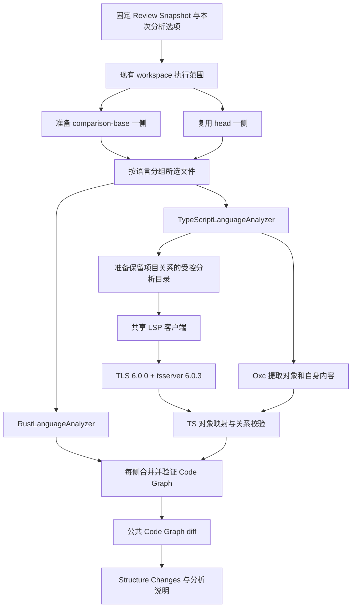

# TypeScript Code Graph 接入调研与设计草案

日期：2026-09-14。核查基线：`0c6f7ed41ea92ae6f384f0f302356145d6d3e904`。

状态：产品范围已收敛；工程推荐 Oxc + typescript-language-server 6.0.0 + tsserver 6.0.3。
已完成 23 个真实 LSP 会话的方案验证；通用项目投影器和生产适配器尚未实现。
本文是调研与设计记录，不表示生产实现已经完成。
后续决策更新（2026-09-15）：用户明确禁止重复复制文件，所有语言必须复用同一侧的
Git workspace。生产实现改为 tsserver 只读文件接口、内存配置和包路径映射；下文关于
临时源码目录的建议与探针保留为历史记录，当前契约以
[规范 0021](../specs/0021-typescript-language-analyzer.md) 为准。
本轮按 `grill-with-docs` 同时应用 grilling、domain-modeling，并用 research 收集一手资料。
外部后端资料见 [分析后端调研](typescript-code-graph-backends.md)。
VS Code 当前稳定版的实际架构与 JS 支持见 [VS Code 参考](typescript-vscode-reference.md)。
本次继续验证的结果见 [LSP 实验报告](typescript-lsp-validation.md)，后续实施边界见
[集成清单](typescript-integration-checklist.md)。

## 建议方向

沿用现有“语言适配器提取 Code Graph，公共模块比较两侧图”的架构。用户本轮明确
偏向 **LSP + Oxc**；真实 LSP 探针支持继续采用该路线，不把上一轮 Compiler API 建议写成最终选择。

上一轮的排序有两处需要修正。第一，LSP 是协议，不等同于 TypeScript 7；
`typescript-language-server` 可以把传统 tsserver 的能力转换为 LSP。第二，用户要求
默认“仓库内 + 标准库”，与现有 Rust 的依赖加载范围一致；这不自动增加对任意服务器
输入的完整文件系统沙箱要求。必须验证第三方不进入默认语义上下文，但不能据此断言
只有 CompilerHost 能满足。现有 Rust 边界见 [0019 规范](../specs/0019-rust-language-analyzer.md)。

本轮验证后的工程选择为：

1. **Oxc + typescript-language-server 6.0.0 + tsserver 6.0.3**。Oxc 在 Rust 内提取
   源码对象和自身内容；LSP 提供定义、引用和调用层级证据。已验证包装层的项目控制、
   TS5.9/6.0 代表性输入、Node 模块与运行时声明；生产适配仍需完整验收。该路线需要 Node。
2. **Oxc + TypeScript 7 原生 LSP**。保留为原生服务候选；不因协议相同就忽略旧配置、
   默认依赖范围和生命周期差异。已有小样本查询成功，尚未完成这些验收。
3. **固定 Compiler API + 自有分析进程**。作为 LSP 无法提供必要证据或项目控制的备选，
   直接使用官方 AST 与 checker。它控制更细，但也要求自己承担项目会话和协议职责；
   当前没有证据要求优先走这条路线。

完整 LSP 链路已经验证：简单项目可以用显式仓库 roots + `noResolve` 控制范围，
但该方式会破坏 project references 的源码跳转，不能推广为所有项目的默认策略。
**建议通用路线使用临时分析目录：保留配置、references、仓库包结构，仅提供仓库源码
和允许的标准/运行时声明。** paths 与 workspace 包的缺 dist 样例都已通过；通用投影器
仍需实现和测量。普通项目与多项目不在生产中自动切换两套后端。

**支持 TypeScript 5/6 项目不应成为一个可有可无的兼容备选。** 建议把常见 TS5/6
项目不必升级源码或配置作为首版验收目标。固定 TS6 也不是自动等价于 TS5 的承诺。
不能让两个后端在 before/after 之间静默切换；首版也不默认同时交付两个后端。

纯 Oxc、SWC 或 Tree-sitter 可以提取结构，但不应被当作与 TypeScript 类型检查器等价的
跨文件语义后端。库名中的 semantic、import resolver 和完整类型解析是不同能力。

当前 npm `typescript` 已是 7.0.2；官方说明 7.0 尚无稳定程序 API，发布包中的
`unstable/*` 入口也不能当成稳定契约。旧 API 可通过 `@typescript/typescript6` 使用，
7.1 的 API 稳定化仍在计划中。因此不能写一个无版本约束的
`import ts from 'typescript'`，再假定它始终提供 `createProgram`。
[官方发布说明](https://devblogs.microsoft.com/typescript/announcing-typescript-7-0/)、
[Compiler API 文档](https://github.com/microsoft/TypeScript/wiki/Using-the-Compiler-API)、
[7.1 计划](https://github.com/microsoft/TypeScript/issues/63703)。

## 本轮已确认的范围

- 默认语义上下文为仓库内代码与标准库，业务第三方依赖不进入默认分析。
- 按上一轮 Q3 的确认，基础类型上下文包含 ECMAScript 声明，并按项目环境提供
  DOM/Node 运行时声明。Node 类型的固定版本和必要传递声明属于发行细节，不能扩成
  自动加载任意 `@types` 包。
- TS/TSX 与 JS/JSX 同批覆盖。JSDoc 复用语言服务已有能力，不增加专用适配。
- 用户进一步澄清：已有的 JSDoc 解析和推断自然保留，无需主动屏蔽；首版不为此增加
  专用解析器、契约模型或比较流程。通用流程已经提供的信息可以使用，需要额外复杂
  适配的能力不作为首版要求。
- LSP + Oxc 是用户偏好的主方案；工程推荐固定 TLS 6.0.0 + tsserver 6.0.3，完整实现仍需兼容和范围验收。
- Q6–Q8 已确认：展示仓库内组件使用关系；HTML 标签不建立对象或关系；跨文件合并声明
  分别显示各处源码；测试按明确文件约定识别，复用现有测试开关。
- Q5 按用户“区分成本低则保留”的条件收敛：直接 const 绑定的箭头函数独立建模，
  链式调用中的匿名回调不单独建模。Oxc 已有语法字段足够完成该判定，无需特殊框架适配。
- 开发阶段沿用现有外部工具路径约定：预先提供固定版本工具，缺失时明确报错，
  不隐式下载。现有规范已将自动安装和正式包内分发延期，本轮不把捆绑 Node 作为
  额外审批问题。参见 [0019 工具约定](../specs/0019-rust-language-analyzer.md#local-server-executable)
  和 [0020 集成约定](../specs/0020-structure-changes-review-view.md)。

## 第二轮范围修订：JS/JSX 与版本兼容

### JavaScript 与 JSX 建议同批覆盖

经用户质疑后，将原来的“先 TS/TSX”建议修订为同一适配器覆盖 TS、TSX、JS、JSX，
并包含 MTS/CTS/MJS/CJS 和声明文件。JS 与 TS 的许多语法、图对象和语义后端可以共用，
不需要为 JS 重新实现一套 Code Graph；但必须选择正确的语言和模块模式，不能把 .js
改名为 .ts、.jsx 改名为 .tsx 后直接当作等价分析。

| 增量工作 | 相对成本判断 | 说明 |
| --- | --- | --- |
| 文件分流、解析模式、语言标签 | 低 | 后端已有四种文件形式，公共图不需要增加类别 |
| 普通函数、类、箭头、对象成员映射 | 低至中 | 主要映射共用，补充 JS 特有声明/导出模式 |
| jsconfig、allowJs/checkJs、无配置工程 | 中 | 不可修改真实 tsconfig；checkJs 控制诊断，不等于能否提供符号信息 |
| JSDoc | 保留原生能力，不安排专用适配 | 语义服务接收原文，已有推断自然使用；不增加专用契约提取与比较流程 |
| CommonJS 与 ESM 的解析 fixture | 中 | 同时也是 Node/CTS/MTS 支持的必要工作，不全算在 JS 增量里 |
| 任意原型修改、动态 require、运行时元编程 | 高且不保证静态唯一目标 | 首版保守表示未知，不把完美动态分析作为“支持 JS”的门槛 |

这些是工程复杂度判断，没有声称可测量的人天或百分比。本次仍未实现图适配器，无法
给出可靠工时。建议一次覆盖文件家族，并明确可静态确认关系的边界。
更细的 parser 对比见 [Oxc / Tree-sitter 与 JS 增量](typescript-parser-comparison.md)。

参考 VS Code 常规语言服务时，还要支持 `.js` 文件中的 JSX。TS6 将 JS 与 JSX 两种
ScriptKind 都设为 JSX language variant；Oxc 0.150 的 `.js` 默认模式却关闭 JSX。
适配器需显式对齐这一差异，不能只照搬 `from_path`；这也不表示 Node 能直接执行 JSX。
[固定版语义服务源码依据](typescript-vscode-reference.md#jsjsx-与项目上下文)。

### TypeScript 5/6 是兼容目标

| 正式版本 | 发布日期 | 一手来源 |
| --- | --- | --- |
| TypeScript 5.0 | 2023-03-16 | [5.0 发布说明](https://devblogs.microsoft.com/typescript/announcing-typescript-5-0/) |
| TypeScript 6.0 | 2026-03-23 | [6.0 发布说明](https://devblogs.microsoft.com/typescript/announcing-typescript-6-0/) |

“分析器使用哪个版本”与“能够分析哪个版本项目”不是同一个问题。TS5/6 中大量语法
仍然可被较新工具读取；实际兼容风险包括 tsconfig 的移除项/默认值、JS 的特殊推断、
模块解析与库声明变化。Narrant 自己目前就在使用 TS5.9.3，不能把支持它视作额外选配。

建议首版验收包含现有 TS5/6 项目的常见配置和 Node ESM/CJS 模式，不要求用户为了查看
Structure Changes 升级仓库。至少用 TS5.0、5.9、6.0 的代表性项目覆盖差异，之后再固定
分析引擎版本或有限兼容策略。选择 TS6 并不能免除这一步；准确的逐小版本行为也不能
仅凭“大版本向后兼容”推断。当前已实测的 TS7 baseUrl 错误见后文。

### Node.js 模块解析也是首版的一部分

TypeScript 的解析必须保留项目实际的 `module`/`moduleResolution` 语义，包括
Node16、NodeNext、旧 Node10 和 Bundler 的区别。它们在具体引擎中是否支持属于版本
兼容检查，不能给所有项目统一强制成 Bundler。还需要读取本侧的 package.json：

- `type` 和文件扩展名共同区分 ESM/CJS；MTS/MJS 与 CTS/CJS 分别有明确方向。
- `exports`/`imports`、条件导出与子路径限制影响目标选择；import 与 require 可能去不同文件。
- `.ts` 中引用 `./service.js` 可能经 TypeScript 的扩展名替换定位到源码 `service.ts`。
- `paths` 是编译分析映射，不会自动修改 Node 的运行时解析；不能用分析器自己的
  Node `require.resolve` 代替被审查项目的 TypeScript 解析器。
- 仓库内 workspace package 属于一方代码；不能因为它通过包名导入就当成第三方丢弃。
  快照缺失 node_modules 链接时，需要验证按仓库 manifest/配置建立解析视图的策略。
- 静态 CommonJS 与动态 require 分开处理；尤其 JS 中 CommonJS 的特殊推断不能假设
  与 .ts 中任意普通 require 调用完全相同。

不将第三方源码/声明纳入语义上下文，不等于禁止读取必要的包配置元数据。读取 package.json
只为确认模块格式/入口/范围，不代表已确认其中的导出符号，也不允许将第三方对象加入
解析上下文。相关元数据同样需要固定来源，不能无条件借用用户当前 checkout 的状态。
[TypeScript 模块参考](https://www.typescriptlang.org/docs/handbook/modules/reference.html)、
[Node 包规则](https://nodejs.org/api/packages.html)。

分析工具的 Node 版本只用于运行 worker；被审查项目的 Node 运行环境决定项目 API 和
模块语义。两者不能混用，也不意味着用户必须更改项目使用的 Node 版本。

## 现有系统提供的边界

| 已确认事实 | 接入含义 | 本仓库依据 |
| --- | --- | --- |
| `AnalysisInput` 是固定一侧仓库根、相对文件列表和 `include_tests` | 分析器不负责选择 revision 或切换用户工作区 | [analyzer.rs](../../src-tauri/src/structure_review/code_graph/analyzer.rs) |
| `files` 决定图成员，可读取其他文件来解析符号 | 不把整个 tsconfig 工程全部塞进图 | [0018 规范](../specs/0018-structure-review-code-graph.md) |
| 六类节点、开放的 language/native kind、Node/External/Unresolved 已存在 | 新语言不需要重写公共图或 diff | [node.rs](../../src-tauri/src/structure_review/code_graph/node.rs) |
| 每个节点只有一处声明 placement；引用可成环 | TypeScript Symbol 的声明合并不能直接照搬进包含树 | [graph.rs](../../src-tauri/src/structure_review/code_graph/graph.rs) |
| 稳定 ID 对应两侧对象；不推断重命名或移动 | 不能使用绝对路径、LSP range、compiler 内部 symbol ID 作为持久身份 | [diff.rs](../../src-tauri/src/structure_review/code_graph/diff.rs) |
| signature/code 是自己的内容；source 只供展示 | 子方法修改不能使整个类的自身内容被判修改 | [node.rs](../../src-tauri/src/structure_review/code_graph/node.rs) |
| 应用只注入 `analyze_rust`，coverage 只接受 `.rs`，闭包绑定 RustDependencyScope | 需要语言分流、组合及选项冻结 | [application/mod.rs](../../src-tauri/src/structure_review/application/mod.rs) |
| 前端已经按节点 language 展示原文 | 源码差异面板大部分可复用 | [structure-details.tsx](../../src/components/structure-review/structure-details.tsx) |
| 展示层隐藏全部 External/Unresolved，并单独隐藏 Rust use 对象 | 降级说明和 TS import 展示必须单独设计 | [graph-presentation.ts](../../src/structure-review/graph-presentation.ts) |

最新 Rust 关系实现保留 calls、imports、writes、函数值 references、macro_use 和结构关系；
`code.type_use` 只从 record/tuple 字段指向图内 Type，不提取一般类型使用或数据读取。
[references.rs](../../src-tauri/src/structure_review/rust_analyzer/references.rs)、
[0019 当前关系范围](../specs/0019-rust-language-analyzer.md#relationship-extraction-scope)。
部分早期通用文档尚未描述后来恢复的字段类型边，设计时应对照最新实现。

现有 before 准备与 after 分析已经并行，成功前等待两侧实际 worker 和清理完成。
后续接入要继续使用 Review Lifecycle 的 workspace 执行范围；它防止应用内刷新/关闭
改动正在分析的 head，但没有提供对外部进程或未跟踪依赖文件的完整快照隔离。
[ADR 0031](../adr/0031-reuse-review-head-for-structure-analysis.md)。

## 建议的处理流程



图中表示本轮推荐的 LSP + Oxc 主方案。传统 tsserver 的 LSP 包装已有验证证据；
原生 TS7 保留为候选，不在一次 before/after 比较中静默混用。
Compiler API 自有进程是架构备选，未在主流程中并行引入。语言处理步骤在各自侧独立执行。
先保留已有两侧并行；不要再默认把每种语言、
每个 tsconfig 都无界并行。性能需要测量冷启动、峰值内存和真实项目加载，不能从解析器
微基准或编译器全量构建宣传推断最终交互时间。

TypeScript/JavaScript 适配器建议分成四个内部职责，均由一个小接口隐藏：

1. 项目上下文。发现有效 tsconfig、extends、project references，准备保留目录关系的受控输入，保存本侧配置和 URI 映射。
2. 语法提取。保存原文、声明范围、词法 owner、规范化自身内容和引用 occurrence。
3. 语义映射。通过选定后端的 checker 或服务查询，追溯 alias/re-export，并验证目标确实对应所需声明类别。
4. 图构建。将同一声明映射成稳定 NodeId，明确 Node、已解析图外符号和 Unresolved，再交公共验证。

## TypeScript 对象映射

以下沿用公共类别；Q5–Q8 涉及的产品取舍已确认，其余为待实现验证的映射细节。

| 源码形式 | 建议映射 | 必须保留的边界 |
| --- | --- | --- |
| 语义确认的模块、namespace | Container | 不把所有源文件无条件视为语言模块；全局 script 要区别处理 |
| class、interface、type alias、enum | Type | 类/接口的自身声明不重复包含独立成员 |
| function、method、constructor、getter/setter | Callable | 实现属于自己的 code，声明签名不混入函数体 |
| `const load = (...) => ...` 等直接命名箭头绑定 | 独立 Callable，已按 Q5 收敛 | 名称来自绑定标识符，不重复生成 Value；不把内联回调一起提升 |
| 普通变量、字段、属性、枚举成员 | Value | 初始化内容仍应参与差异比较 |
| 模块顶层执行语句、class static block | ExecutionRegion | 不给每个普通函数额外包执行区域 |
| import/export/re-export 声明 | 建议 Extension | 导出 API 的变化必须可比较；显示隐藏与图中是否保留分开 |
| 行内 callback | 留在最近建模对象的 code | 不生成匿名 Callable；代码和内部引用仍保留；callback 中显式具名声明另按声明规则处理 |

### 具名箭头与内联回调的最小判定

用户希望保留常见的顶层 `const fn = () => ...`，并避免链式调用中的匿名箭头造成图噪声。
区分依据是**源码绑定位置**，不是运行时 `function.name`。最小规则只需要：

1. 当前声明为 const，某个 declarator 的 id 是普通 `BindingIdentifier`。
2. 其初始化表达式解开括号和 TypeScript 透明包裹后，直接为 `ArrowFunctionExpression`。
3. 为这个绑定生成一个 Callable；其内部 map/filter/then 等参数箭头继续保留在自身 code。

Oxc 0.150 已提供 `VariableDeclaration.kind`、`VariableDeclarator.id/init`，以及
`Expression::get_inner_expression()`；后者可解开括号、as、satisfies 等包裹，
不会穿透调用和条件表达式。无需新增类型推断，也无需维护函数式库的方法名列表。
只在分类时解包，源码内容里的类型注解和断言仍参与正常比较。
[声明字段](https://github.com/oxc-project/oxc/blob/crates_v0.150.0/crates/oxc_ast/src/ast/js.rs#L1185-L1229)、
[透明包裹方法](https://github.com/oxc-project/oxc/blob/crates_v0.150.0/crates/oxc_ast/src/ast_impl/js.rs#L229-L250)。

```typescript
export const load = () => users
  .filter(user => user.active)
  .map(user => user.id);
```

上例有三个箭头表达式，只生成一个 Callable `load`；两个参数回调保持内联，修改它们
仍会改变 load 的自身内容。`const fn = memo(() => ...)`、工厂调用、条件表达式、
解构绑定、let/var 赋值不适用这个最小提升规则，按普通声明/表达式保留。
这不是丢弃匿名函数代码或其中的调用观察。

判定本身是低复杂度局部 AST 规则；自身内容投影、稳定身份和 LSP 位置映射仍是完整
适配器的通用工作，不能据此声称所有箭头调用语义已得到验证。

### JSX 与多份声明

对 `memo(() => ...)`、`forwardRef(...)`、工厂返回的函数和 `let` 的可变绑定，不能仅凭名字
大写或拥有 call signature 就套用“直接命名箭头”的规则。首版建议保留可确认的声明与调用，
复用通用语法提取和服务能力，不新增框架专用包装器识别。这是已确认依赖范围下的保守边界，
不把每一种框架写法另列成首版必答问题。

Q6 已确认：JSX 保留在所属函数的自身 code 中，展示已解析到仓库对象的组件使用关系。
适配器可用 `jsx.uses_component` 表示该语义，与普通 `code.calls` 区分；具体标识是工程约定。
`<div>`、`<button>` 等 intrinsic tag 不生成 HTML 对象或组件关系，标签、属性和文本仍属于
源码内容，因此它们的修改仍可改变所属对象的自身内容。不得把“不建图节点”实现成删除原文。
真实 TypeScript LSP 会把 JSX 组件放进 outgoing call hierarchy，必须根据原始 occurrence
重新分类，不能直接照收所有边。
[JSX 语言规则](https://www.typescriptlang.org/docs/handbook/jsx.html)、
[7.0.2 call hierarchy 源码](https://github.com/microsoft/TypeScript/blob/v7.0.2/tsc/internal/ls/callhierarchy.go)。

overload 和 declaration merging 的对象边界需要分别处理：

- 同一 owner 的函数 overload 推荐聚合为一个 Callable，保留所有签名及其顺序和实现，
  不以 LSP 偶然返回的第一个 overload 决定身份。
- Q7 已确认：interface、namespace 跨文件合并时，保留各处源码声明，不跨文件合卡。
  语义服务仍可把多份声明识别为同一符号；适配器保留候选及源码归属，不任意挑第一份
  声明，也不把已知合并符号统称为解析失败。选中文件范围和成员自身差异仍应准确。

Q7 已接受上述展示取舍；同 owner 重载按上述工程建议验证。
公共图的单一 placement 本身不禁止一个语义对象关联多处源码，不能伪称它已经决定了
Q7 的答案；也不能借本次调研改变公共契约。
[TypeScript 声明合并](https://www.typescriptlang.org/docs/handbook/declaration-merging.html)。

## 内容、身份和关系

Q8 已确认：首版用明确的测试文件约定识别 TS/JS 测试，例如文件基名匹配
`*.test.*`、`*.spec.*`，或处于 `__tests__/` 目录；语言扩展名仍限于本次支持的文件家族。
复用 `include_tests`，默认排除这些测试源码及其 outgoing references，两侧使用同一选项。
不仅因 `test/it/describe` 名字出现就排除业务文件中的代码，无法确认的代码保留。

身份建议沿用 `language + 仓库相对路径 + 词法 owner + native kind + 名称/局部消歧`。
默认导出的匿名函数用语言定义的 default export 锚点；重命名/跨文件移动仍允许表现为增删。
同名声明、重载和 getter/setter 要有明确消歧规则。Unicode、不同 checkout 根和操作系统
路径大小写必须进入 fixture，不能把所有路径一律小写。

自身内容通过语法树归一化，独立子对象用稳定占位剔除，原文保持不变供详情展示。
不能直接删除空白：ASI、正则/模板字面量、JSX 文本都可能有实际含义。
JSDoc 原文完整传给语言服务，复用已有解析和推断，不为注解增加专用契约提取或差异流程。
这不要求屏蔽通用语义结果中的信息，也不能据此承诺 JSDoc 修改后整张图恒定不变；
例如注解改变参数类型时，已有语义查询可能返回不同的关系目标。
TypeScript 的 triple-slash reference 和 ts-check 指令等项目/分析输入另行遵循后端语义，
不能为了归一化而修改发送给服务的源码。

建议关系范围先对齐现有产品：calls、imports、writes、函数值 references，以及
inherits/implements/member_of；字段 `code.type_use` 沿用 Rust 的图内 Type 目标范围。
不自动扩大成全程序的数据流、所有类型使用、运行时调用图或 Tauri TS→Rust 桥接。

解析规则需要同时满足以下条件：

- 有语法观测到的调用而不能确认目标时保留 Unresolved；LSP 省略了调用，不等于没有调用。
- definition 指回 ImportSpecifier 时继续验证导入目标；未解析包不能生成指向 import 声明的调用边。
- `getResolvedSignature` 或某个定义候选只说明类型/声明信息，不证明条件变量、虚调用或回调
  最终执行了哪个函数。先定义 code.calls 的静态含义，对不能证明的候选保持保守。
- 已确定且被所选文件包含的声明是 Node；未选中的仓库声明可以是 External。
  同一目标不能因被选入图就获得另一个语义身份。

## 项目配置、依赖和失败

### 第二轮确认与标准库建议

用户已确认：默认不解析第三方依赖；缺依赖仍应保留可靠结构和关系，不能解析的引用保持
Unresolved。这里的默认边界不能被偷偷放宽成“依赖照常加载，只在 UI 隐藏”。

本轮确认默认“仓库内 + 标准库”，按上一轮 Q3 的建议区分以下类型来源：

| 类型上下文 | 建议默认政策 | 理由 |
| --- | --- | --- |
| ECMAScript 与 TypeScript 基础声明 | 随分析引擎提供，遵循项目 target/lib；显式 noLib/自定义基础声明须单独尊重 | Promise、Array、迭代器和工具类型直接影响仓库内目标解析 |
| DOM / WebWorker | 按项目 lib 和环境加载 | 浏览器声明不应无条件灌入所有 Node 工程 |
| Node 运行时声明 | Node 工程使用受控、固定版本的运行时声明包 | Buffer、process、node:fs 等不由 TypeScript 的 lib.es*.d.ts 完整提供 |
| 其他第三方源码和声明 | 默认不加载、不自动安装 | 已确认约束；React 等包的推断链可能变为 Unresolved |

Node 的 `@types/node` 虽通过 npm 分发，描述的是运行时基础 API；它作为受控运行时
类型包，与加载 React/Express 等业务依赖属于不同的产品边界。它还可能依赖其他类型包，
例如本仓库已安装版本声明依赖 `undici-types`；不能白名单一个目录后宣称已经覆盖全部 Node 类型。
Q3 已接受运行时声明范围；版本来源、允许的传递类型包、项目配置优先级仍需固定，
不由宿主机器当前安装的任意包决定。

`types: []` 只限制自动进入全局的类型包；`skipLibCheck` 只跳过声明检查；关闭 ATA 只停止
自动下载类型。它们都不等于禁止读取第三方模块的类型声明。默认语义输入范围须通过
服务项目输入、受控分析视图或文件宿主实现并验证。只决定图成员不进入依赖，不能满足
此约束；这也不等同于额外要求完整 OS 文件系统沙箱。
[types](https://www.typescriptlang.org/tsconfig/types.html)、
[skipLibCheck](https://www.typescriptlang.org/tsconfig/skipLibCheck.html)。

后续完整 LSP 对照已发现：`noResolve` 在 references 项目中会丢失仓库调用目标。
因此通用方案采用保留配置和 references 的临时分析目录，避免向目录提供业务第三方声明，
不统一强制 `noResolve`。受控目录注册配置项目时，范围设置必须写在投影后的配置里；
外层 `openExternalProject.options` 不会覆盖这些配置。多项目需要校验实际项目归属，
不能把全仓默认项目当唯一上下文。细节见 [验证报告](typescript-lsp-validation.md)。

### 标准库实际验证

本轮使用现有 TypeScript 5.9.3 做三组纯内存 Program：`noLib`、仅 `lib.es2022.d.ts`、
`lib.es2022.d.ts + lib.dom.d.ts`。均关闭 emit，`types: []`，没有第三方模块导入。
测试声明 `class Service { save() { return 'ok'; } }`，检查使用它的成员调用定位。

| 场景 | noLib | ES2022 | ES2022 + DOM |
| --- | --- | --- | --- |
| `await Promise.resolve(new Service())` 后的 `item.save()` | 无目标，item 为 any | 定位 Service.save | 定位 Service.save |
| `[new Service()].map(item => item.save())` | 无目标，item 为 any | 定位 Service.save | 定位 Service.save |
| `new Map(...).get(...)` 后的 `item?.save()` | 无目标 | 定位 Service.save | 定位 Service.save |
| `for...of new Set([new Service()])` 中的 `item.save()` | 无目标 | 定位 Service.save | 定位 Service.save |
| `Partial<Service>` 的 `item.save?.()` | 无目标 | 定位 Service.save | 定位 Service.save |
| `await service`，service 标注 `Promise<Service>` | 无目标 | 定位 Service.save | 定位 Service.save |
| `document.querySelector('button')?.click()` | 无目标 | 无目标 | 定位 lib.dom.d.ts 的 click |

三组均解析出同样的 8 个顶层声明。差别发生在语义上下文和目标定位，不是 parser 不能
识别 async/await、数组或泛型语法。样例只证明这些机制，不能当作完整覆盖率或性能基准。

Array/Object/Function 等基础接口以及 Partial/Record/Pick 等工具类型由声明库提供；
Promise、Iterable、Symbol.iterator/asyncIterator 等又连接到 await、迭代、展开等语法。
所以即使画布只展示仓库对象，基础库也能恢复仓库对象之间的关系。
[lib](https://www.typescriptlang.org/tsconfig/lib.html)、
[noLib](https://www.typescriptlang.org/tsconfig/noLib.html)、
[Utility Types](https://www.typescriptlang.org/docs/handbook/utility-types.html)。

### 快照上下文与运行错误

图的提取范围与语义上下文分开。所选文件只决定输出对象，服务仍可能需要同侧的
tsconfig、package.json、paths、exports、依赖类型和 project references。
solution-style 根配置和多个项目不能简化为“最近一个 tsconfig 一定正确”；首版必须用
monorepo fixture 检验工程归属、源代码引用和陈旧 `.d.ts` 产物。

两个快照分别读取自己的已跟踪配置和 manifest。冻结相同的是分析器版本、映射约定和
用户选项，**不是强迫两个版本拥有相同 tsconfig 或 lockfile**。
依赖可用性另记分析上下文，不默默借用用户 checkout 的当前 node_modules 来代表历史版本。
自动安装依赖、运行仓库配置脚本或构建项目不作为默认分析步骤。

按已确认的无依赖也出图方向，建议在语义后端正常运行时保留可靠结果与 Unresolved，并在
application report 中附加配置/缺依赖说明；这些运行诊断不放进参与 diff 的 node.extensions。
服务启动失败、请求超时、读取所选文件失败仍是错误；不静默切成语法图后宣称语义分析成功。
现有返回值只有图或错误、coverage 只有文件状态，要单独设计运行诊断的应用层承载方式。

依赖或分析器发生变化时，现有只按 Snapshot/选项复用的结果需要失效。
两侧语义信息可用性不一致应提示，不能把“这次解析得更多”解释为确定的运行时调用变化。
若一种语言整体失败，沿用当前整个比较失败的规则；本轮不新增部分语言成功的展示模式。

TypeScript 7 LSP 必须关闭自动类型获取。本次验证使用：

```json
{
  "capabilities": { "workspace": { "configuration": false } },
  "initializationOptions": {
    "userPreferences": {
      "tsserver": { "automaticTypeAcquisition": { "enabled": false } }
    }
  }
}
```

这是 7.0.2 的嵌套配置，不能当成所有 TS LSP 的通用配置；启动命令是原生二进制
`--lsp --stdio`。平台包还需要标准库声明、许可文件和版本校验，不能只复制可执行文件就
假定发行完成。[原生入口](https://github.com/microsoft/TypeScript/blob/v7.0.2/tsc/cmd/tsgo/lsp.go)、
[配置解析](https://github.com/microsoft/TypeScript/blob/v7.0.2/tsc/internal/ls/lsutil/userpreferences.go)。

## 已实际运行的探针

这是调研证据，不是 Narrant 功能实现或生产验收。

### 传统 Compiler API

使用本仓库已安装的 TypeScript **5.9.3**，创建纯内存 Program；没有安装依赖或 emit。
样例包含 math.ts、barrel.ts、page.tsx、自定义最小 JSX 声明以及一个故意缺失的包。

| 场景 | 观察 |
| --- | --- |
| paths → re-export → import alias → 命名箭头 | symbol 能追溯原始 VariableDeclaration，签名指向 ArrowFunction |
| JSX `<Card />` | 能定位 Card 的绑定声明 |
| 函数 overload | symbol 返回两个签名和实现，resolved signature 只返回选中的签名 |
| 同名 interface 合并 | symbol 返回两份声明 |
| 缺包 | TS2307；本地符号仍可解析；缺包符号没有真实 declarations |
| 注释和普通格式变化 | printer 的归一化结果相同 |
| ASI、JSX 文本空格、字符串内容变化 | printer 的归一化结果不同 |

特别是 `const cb = mode ? step : (n: number) => n - 1; cb(1)`，
`getResolvedSignature().declaration` 返回了 step 的箭头声明，`type.isUnion()` 仍为 false。
这足以否定“有唯一调用签名就能确认执行目标”的映射方法。
这些观察只覆盖 5.9.3 的样例，不是对 6.x、7.x 或 Oxc 的验证。

### 原生 TypeScript 7.0.2 LSP

从 npm 获取 `@typescript/typescript-darwin-arm64@7.0.2`，按 registry 给出的 SHA-512
完整性校验后在系统临时目录运行。压缩包为 9,270,373 字节，这不是最终安装包的增量体积。
测试工程未安装 node_modules，关闭 ATA，服务 PATH 不含外部工具，直接运行原生二进制。

| 场景 | 观察 |
| --- | --- |
| initialize | 支持 definition/typeDefinition/documentSymbol/callHierarchy，协商 UTF-16；未声明 typeHierarchy |
| paths + 两层 alias/re-export | definition 返回 math.ts 中 increment 的位置 |
| 命名箭头 Card | documentSymbol 报 Variable，但 prepareCallHierarchy 报 Function，证明不能按单一 LSP kind 直接分类 |
| JSX `<Card />` | definition 能定位 Card；render 的 outgoing 中包含 Card |
| 条件绑定 cb | definition 返回 cb 和 increment 两个位置；outgoing 省略 cb |
| 缺包 unavailable() | definition 返回本地 import 的位置；outgoing 省略该调用 |
| overload choose | outgoing 目标落在首个签名范围，需要适配器归并 |
| 旧 baseUrl 配置 | 独立 `--noEmit` 检查返回 TS5102，说明 7.x 兼容问题会实际出现 |
| shutdown 带 `params: null` | 返回 -32602，要求省略 params；现有共享 LspClient 正是发送 null |
| shutdown 省略参数 | 收到成功响应；随后 exit 的进程仍以 1 退出，stderr 为 context canceled，需继续验证生命周期兼容 |

当前仓库自身 [tsconfig.json](../../tsconfig.json) 使用 baseUrl，所以旧配置验证并非假设场景。
不能修改真实快照配置来“修好”分析。可以评估传统后端或有明示范围的只读配置适配，
但后一种方案必须证明解析语义一致，不能直接删除未知/过时选项。

TypeScript 7.0.2 的功能探针成功拿到了查询结果，**没有证明生命周期适配已完成**。
还未运行 Oxc 实际提取、两侧 CodeGraph 比较、完整 React 类型库、project references、
Windows/Linux 分发、资源压力或 Narrant UI 验收。源码和能力事实由
[7.0.2 LSP 实现](https://github.com/microsoft/TypeScript/blob/v7.0.2/tsc/internal/lsp/server.go)交叉核对。

原生探针的关键输入如下，所有文件均为临时样例，没有运行被分析程序：

```typescript
// math.ts
export const increment = (n: number) => n + 1;
export function choose(x: string): string;
export function choose(x: number): number;
export function choose(x: string | number) { return x; }

// barrel.ts
export { increment as inc, choose } from './math';

// page.tsx
import { inc as step, choose } from '@lib/barrel';
import { unavailable } from 'missing-package';
export const Card = (props: { n: number }) => <section>{step(props.n)}</section>;
export function render(mode: boolean) {
  const cb = mode ? step : (n: number) => n - 1;
  cb(1); choose('x'); unavailable();
  return <Card n={step(1)} />;
}
```

现代配置使用 `moduleResolution: bundler`、`jsx: preserve`、`noEmit: true`、`types: []`、
`paths: { "@lib/*": ["./*"] }`，并附最小 JSX 声明。旧配置检查只额外加入 `baseUrl: "."`。
源码中的原生标准库之外没有安装第三方依赖。复测流程为 initialize → initialized →
didOpen → documentSymbol/definition/prepareCallHierarchy/outgoingCalls → shutdown → exit。
临时脚本和原始 JSON 位于系统临时目录 `narrant-typescript-graph-kqEW8Q/`，关键输入、
版本和结果已经保存在本文，不依赖临时目录长期存在。

### tsserver 项目范围探针

本轮另外使用现有 **TS5.9.3 的 tsserver 进程**，通过它的服务协议执行
`openExternalProject`、`projectInfo` 和 `definition`，没有直接创建 Compiler API Program。
临时工程包含四个仓库文件：`model.ts` 声明 `Service.save`，`barrel.ts` 重导出
`Service as LocalService`，`main.ts` 通过 barrel 和 Promise 调用本地方法，
`main.js` 通过 CommonJS require 调用同一方法。另预置一个样例第三方包及其 `.d.ts`。

三个独立 tsserver 会话都关闭 ATA，使用相同项目选项：

```json
{
  "target": "es2022",
  "module": "commonjs",
  "moduleResolution": "node",
  "lib": ["lib.es2022.d.ts"],
  "allowJs": true,
  "checkJs": false,
  "types": [],
  "noEmit": true
}
```

这里是 tsserver 协议中的 options，`lib` 使用声明文件名，不是可直接复制到 tsconfig 的
JSON 示例。外部项目另设置 `typeAcquisition: { enable: false }`；进程使用
`--disableAutomaticTypingAcquisition`。每个会话查询相应 `projectFileName`，结束时发送 exit。

| 输入组合 | 第三方声明进入项目 | 仓库 / 标准库文件数 | TS 经 barrel + Promise 的本地调用 | JS CommonJS 本地调用 |
| --- | --- | --- | --- | --- |
| 两个入口 roots，noResolve=false | 是 | 4 / 57 | 定位 model.ts 的 Service.save | 同左 |
| 完整四个仓库 roots，noResolve=true | 否 | 4 / 57 | 定位 model.ts 的 Service.save | 同左 |
| 漏列 model/barrel，noResolve=true | 否 | 2 / 57 | 无目标 | 无目标 |

受限组的第三方成员查询返回空目标。该结果证明服务协议存在项目范围控制入口，
也证明 `noResolve` 需要完整允许的项目文件清单，不能仅拿选中构图文件充当语义根。
项目文件列表来自 `projectInfo`，没有做 OS 文件读取跟踪，不应宣传为文件系统沙箱。

原始结果留在系统临时目录 `narrant-tsserver-scope-E2pBOg/evidence.json`；关键输入和观察
已记录在此，不依赖临时目录长期存在。这个早期探针本身没有验证 TLS 包装后的
didOpen/project 选择、TS6、多项目/references、Node 类型包或跨平台发行。
TLS v6.0.0 公开提供 `typescript.tsserverRequest`，可通过 LSP 的 executeCommand
透传 `openExternalProject`；后续包装层实测已经完成，见下一节。
[外部项目协议](https://github.com/microsoft/TypeScript/blob/v5.9.3/src/server/protocol.ts#L1388-L1407)、
[TLS 透传命令](https://github.com/typescript-language-server/typescript-language-server/blob/v6.0.0/src/commands/tsserverRequests.ts#L20-L51)。

### TLS 6.0.0 完整链路验证

在固定 TLS 6.0.0 中分别运行 TS5.9.3/TS6.0.3，经 initialize → 注册项目 → didOpen →
标准 definition / call hierarchy → shutdown / exit。23 个独立会话、45 组结果检查符合预期。

- 简单受限项目在 didOpen 后仍使用预期项目，第三方声明不进入语义上下文；本地 TS/JS 调用保留。
- baseUrl/paths/barrel 可解析；TS6 的 baseUrl 产生弃用诊断，不能误称已删除。
- Node16/NodeNext 的 import/require 条件、包 self imports/exports、扩展名替换分别正确。
- 原生 JSDoc 可恢复 JS 到仓库类型的方法关系；`.js` 中 JSX 和 callback 内部调用均可查询。
- 固定 Node 类型可恢复 AsyncLocalStorage 包装后的本地调用；业务第三方仍未纳入范围。
- 平铺 roots + noResolve 以及 configured + noResolve 都在 references 样例失败；保留项目
  结构的临时目录使 paths/workspace 包导入恢复源码跳转，同时排除样例第三方。
- 多项目共享文件的标准查询会选默认项目，需明确上下文；不能把这个偶然选择当唯一关系。
- 23 个正常会话接受 shutdown 的 null 参数并以 0 退出，有界等待后进程组清空；尚未验证应用级取消。

完整 fixture、负例、限制和复现脚本见 [LSP 验证报告](typescript-lsp-validation.md)。
这批实验没有实现生产 Oxc 节点提取、通用目录投影器或应用集成。

### 箭头分类的语法验证

本轮用已有 TypeScript **5.9.3** 的 `createSourceFile` 做纯语法遍历，没有创建 Program、
TypeChecker 或语言服务。遍历 const 声明，匹配标识符绑定，并只解开括号/as/satisfies/
非空断言等透明表达式后检查直接初始化的箭头。

| 样例 | 箭头总数 | 独立 Callable 绑定 | 内联箭头数 |
| --- | --- | --- | --- |
| load 包含 filter + map | 3 | load | 2 |
| load 包含 then + filter | 3 | load | 2 |
| load 初始化为带 satisfies 的箭头 | 1 | load | 0 |
| Card 初始化为 memo(箭头) | 1 | 无 | 1 |
| load 初始化为两个箭头的条件表达式 | 2 | 无 | 2 |

五个 TSX 样例均无解析错误。此探针说明分类不依赖 checker；Oxc 的对应可行性来自
上文固定版本 AST 源码核验。没有实际运行 Oxc 图提取或 Narrant 端到端图比较，不能
混称为 Oxc 运行测试或生产验收。

## 落地阶段与验收

| 阶段 | 工作 | 离开该阶段的依据 |
| --- | --- | --- |
| 0. 后端和项目上下文 | TLS6 + tsserver6 样例验证已完成；下一步实现真实仓库的分析目录、项目归属、运行时 profile 和 URI 映射 | 保留 references/模块规则，第三方不进入默认项目；配置兼容、取消清理和真实仓库成本通过验收 |
| 1. 对象模型 | 明确命名箭头、overload、合并声明、模块、测试识别及 JSX 粒度 | fixture 对照明确预期；公共图验证通过；无重复自身内容 |
| 2. 语义关系 | imports/reexports、calls、writes、函数值、继承实现和不确定目标 | 无假连接；缺包与动态调用仍有明确观测；位置换算正确 |
| 3. 应用组合 | 语言分流、合图、coverage、取消、同侧诊断、缓存失效 | Rust+TS 混合增删、语言改名、某语言失败和空侧都不制造假差异 |
| 4. 展示与工具接入 | TS import/JSX 展示、局限说明、固定服务和运行时路径 | 类型/Lint/构建及相关测试通过，Preview Harness 真渲染和外部工具启动验证完成；自动安装与正式打包仍延期 |

核心 fixture 至少包括：TS/TSX/JS/JSX/MTS/CTS/MJS/CJS/声明文件；跨文件别名和 barrel；
jsconfig、allowJs/checkJs、无配置 JS；TS5.0/5.9/6.0 配置；Node ESM/CJS 与条件导出；单仓多 tsconfig；
project references 与缺失/陈旧声明产物；overload 与跨文件合并；命名箭头与行内 callback；
函数成员/继承/实现；动态绑定和缺依赖；默认导出；测试 include/exclude；
纯格式及注释、ASI/模板/正则/JSX 文本；非 ASCII/emoji/CRLF 的 UTF-8↔UTF-16 位置；
两个不同 checkout 根的稳定 identity；成员修改不污染父对象；取消时回收所有子进程；
已安装第三方包时其源码和声明仍不进入默认项目；标准库与运行时类型闭包有明确来源和版本。
JSDoc 保留已有能力，不增加专用适配，送往语义服务的原文完整保留。

Rust 验证遵循仓库 `scripts/cargo-agent.sh` 和每个 Issue 的全量测试节奏；
前端涉及布局/交互时遵循 `pnpm dev:preview` 真实渲染验收；不手动触发 quality-gate。
本文未创建实现 Issue、提交或 PR。

## 访谈设计树

已从现有规范继承：目标是 Structure Changes；TSX 作为 TypeScript+JSX；复用六类对象和
两侧图比较；暂不推断跨语言桥接、重命名和移动。

第一轮问题及用户反馈（2026-09-14）：

| 问题 | 建议 | 回答状态 |
| --- | --- | --- |
| Q1：本次只做 TypeScript/TSX，还是同时 JS/JSX？ | 经成本核查已将草案改为同批覆盖 | 采纳用户建议作为新草案范围 |
| Q2：快照无 node_modules 时呈现什么？ | 正常后端返回可靠结构与关系，保留 Unresolved，明确分析局限 | 已确认；默认仓库内 + 标准库 |

第二轮的事实问题是 JS/JSX 增量成本、标准库及宿主运行时类型的作用、Oxc 与 Tree-sitter
的取舍、TypeScript 5/6 的版本时间和兼容范围、Node.js 模块解析。这些事实由调研回答，
不交给用户猜测。默认仓库内 + 标准库已经确认；JSDoc 原生能力保留，不安排特殊适配。

第三轮用户反馈：

| 问题 | 建议 | 回答状态 |
| --- | --- | --- |
| Q3：默认语义上下文是否包含 ECMAScript 基础库，以及项目需要的 DOM/Node 运行时声明？ | 包含基础库，按项目环境加载 DOM 或受控 `@types/node` 及其必要类型依赖；业务第三方依赖仍关闭 | 用户回答“3. ok”，并重申默认仓库内 + 标准库 |
| Q4：是否接受随应用交付独立 Node 分析进程？ | 用户偏向 LSP + Oxc；工具交付沿用现有开发约定 | 审计后撤回重复确认：自动安装与正式捆绑已由现有规范延期，不作为本轮必答问题 |
| JSDoc | 保留服务已有能力，不增加特殊适配 | 用户进一步澄清：此前担心的是额外复杂度，已有能力可以保留；不主动屏蔽通用结果 |

第四轮用户反馈已收到，Q5 的实现复杂度已由语法核验回答：

| 问题 | 推荐方案 | 状态 |
| --- | --- | --- |
| Q5：具名箭头的对象粒度 | 直接 const 绑定的箭头作为独立 Callable，不重复生成 Value；行内匿名回调留在 owner | 按用户条件收敛；Oxc 现有语法结构足够，分类无需复杂适配 |
| Q6：JSX 组件关系 | 显示已解析到仓库对象的组件使用关系，与普通 calls 区分；不生成 HTML 元素节点 | 已同意；用户再次强调 div/button 不建图 |
| Q7：跨文件 interface/namespace 合并声明 | 保留各处源码声明，语义服务仍识别同一符号，首版不跨文件合卡 | 已同意 |
| Q8：TS/JS 测试识别约定 | 按 `*.test.*`、`*.spec.*`、`__tests__/` 等明确文件约定识别；不凭 test/it/describe 名字删除混合业务代码，无法确认时保留 | 已同意 |

以下事项从已有约定继承，不重复要求用户选择：

- 六类对象、所选文件决定图成员、自身内容不重复子对象、稳定身份和 Node/External/Unresolved。
- 测试默认不分析，两侧同选项；未知或共享代码保留。Q8 只确定语言特有识别约定。
- 图中继续隐藏 External/Unresolved；后端错误不能变成成功空图，混合语言沿用整次比较失败。
- 匿名行内回调留在 owner；首版不加入框架专用包装器识别或跨语言调用推断。
- 外部工具路径和缺失报错沿用现有开发边界；正式安装与发行不在本轮扩大范围。

工程实现清单不转交用户选择：本轮已用真实 TLS 验证代表性的 didOpen 项目归属、
多项目/references、TS5.9/6.0 与 Node 模块/类型，并据此推荐固定补丁版本和分析目录方案。
仍需完成通用项目投影、无配置项目默认值、完整旧配置矩阵、UTF 位置转换、取消清理、
运行诊断、Oxc 映射与应用验收；研究探针不构成完整功能验收。

当前没有继续要求用户选择的产品问题。技术验证若发现需要改变已确认范围，应带着
具体失败样例重新讨论；不会用潜在问题继续扩大本轮确认清单。

每一轮只问前提已确定的问题。研究发现已经写在这里；待术语或决策形成共识时再更新
CONTEXT.md 或必要的 ADR。当前没有新术语达成共识，也没有把候选技术写成 accepted ADR。
