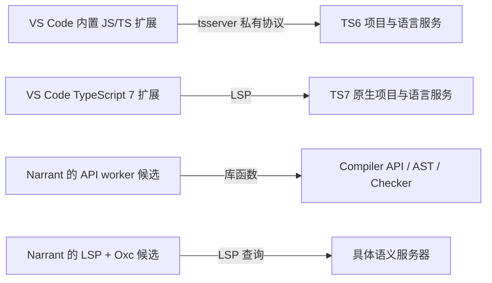

# VS Code 的 JavaScript / TypeScript 支持参考

日期：2026-09-14（Asia/Shanghai）。事实调研；不构成 Narrant 后端采用决定。
本轮仅阅读官方文档、维护者仓库与固定 release 源码，没有安装依赖或执行被分析仓库代码。

## 结论

当前 VS Code 稳定版 **1.137.0** 发布于 **2026-09-09**。该 tag 的内置
`typescript-language-features` 默认仍使用 **TypeScript 6.0.3 的 tsserver 私有协议**。
TS7 原生 LSP 是另一条可通过独立扩展与设置启用的路径；不能把 TypeScript 7 发布时
“将集成到 VS Code”的计划当成当前稳定版已默认切换的证据。
[官方 1.137 发布页](https://code.visualstudio.com/updates/v1_137)、
[GitHub 固定 release](https://github.com/microsoft/vscode/releases/tag/1.137.0)、
[随附 TypeScript 锁定版本](https://github.com/microsoft/vscode/blob/1.137.0/extensions/package-lock.json)

VS Code 的经验支持“使用官方项目语义服务，加上客户端自己的展示/提取规则”这条分工。
它不证明所有语义服务都使用 LSP，也不证明 LSP 返回值已是可直接持久化的 Code Graph。

## Compiler API、语言服务与 LSP 是不同层

| 层 | 负责的事情 | Narrant 会拿到什么 |
| --- | --- | --- |
| Compiler API | 以库函数读取文件、建立 Program/AST，查询 Symbol 和 TypeChecker | 可直接遍历声明、别名、多份声明和类型；自行设计项目宿主与提取规则 |
| Language Service | 在项目与文件版本上下文中提供定义、引用、补全等编辑器查询 | 面向位置的查询结果，不要求调用者直接遍历完整 AST |
| tsserver | 将 TypeScript 语言服务作为进程运行，提供 TypeScript 自身协议 | `definitionAndBoundSpan`、`references` 等请求和结果 |
| LSP | 约定客户端与语言服务器如何交换请求、响应和通知 | `textDocument/definition` 等通用消息；语言语义由具体服务器实现 |

旧 Compiler API 的简单例子是 `program.getTypeChecker().getSymbolAtLocation(node)`：
直接问库“这个 AST 节点绑定到哪个符号”。LSP 的对应使用方式是向进程询问
“文件 A 的第几行第几列定义在哪里”，返回位置。两者可依赖相同语言知识，但暴露层级不同。
官方旧 API 指南明确适用于 TS6 及以前，不能拿它说明 TS7 新 API 已兼容。
[Compiler API 指南](https://github.com/microsoft/TypeScript/wiki/Using-the-Compiler-API)、
[v6.0.3 API 类型](https://github.com/microsoft/TypeScript/blob/v6.0.3/src/compiler/types.ts)、
[VS Code Language Server 指南](https://code.visualstudio.com/api/language-extensions/language-server-extension-guide)

“LSP + Oxc”仍可继续讨论：语法与内容提取放在 Oxc，目标查询交给语言服务器。
而语言服务器还可选择 TS7 原生实现，或 TS5/6 tsserver 外的 LSP 适配层。
例如 `typescript-language-server` 是社区维护的适配器，其当前 README 使用
`typescript@6`；它不是 VS Code 内置扩展本身，也不自动带来 TS7 的语义。
[typescript-language-server 维护者 README](https://github.com/typescript-language-server/typescript-language-server)

## 固定稳定版源码如何选择后端

`1.137.0` 的默认设置 `js/ts.experimental.useTsgo` 为 `false`，旧名称
`typescript.experimental.useTsgo` 保留为弃用兼容设置。
内置 `extension.ts` 只有在设置开启且检测到 native 扩展时，才停用常规 tsserver
功能注册；否则进入常规 client host 与进程工厂。
[默认设置](https://github.com/microsoft/vscode/blob/1.137.0/extensions/typescript-language-features/package.json)、
[切换分支](https://github.com/microsoft/vscode/blob/1.137.0/extensions/typescript-language-features/src/extension.ts)

常规进程工厂启动选定的 `tsserver.js`；可以使用 Node IPC 或标准输入输出，
但传递的仍是 tsserver 协议。传输使用 JSON 或独立子进程，并不意味着它就是 LSP。
[进程启动](https://github.com/microsoft/vscode/blob/1.137.0/extensions/typescript-language-features/src/tsServer/serverProcess.electron.ts)

普通版本选择器可以选择随附或 workspace TypeScript；用户级 tsdk 和 Nightly 扩展
也可能改变默认选择。workspace 的 `js/ts.tsdk.path` 让版本可被发现，通常还需在版本
选择器中选用。普通路径查找的是包含 `tsserver.js` 的安装，不能简单把 TS7 包目录当成
旧服务兼容安装。native 扩展有自己的版本选择和启用命令。
[版本查找](https://github.com/microsoft/vscode/blob/1.137.0/extensions/typescript-language-features/src/tsServer/versionProvider.electron.ts)、
[版本选择器](https://github.com/microsoft/vscode/blob/1.137.0/extensions/typescript-language-features/src/tsServer/versionManager.ts)、
[官方版本选择说明](https://code.visualstudio.com/docs/typescript/typescript-transpiling#_using-newer-typescript-versions)

Marketplace 的旧扩展 ID `TypeScriptTeam.native-preview` 目前显示为 **TypeScript 7**，
仍是独立安装项。内置源码同时识别 `typescriptteam.vscode-typescript` 与旧 ID；
不能仅凭预留的新 ID 断言新 Marketplace 包已经发布或已被内置。
[Marketplace 页面](https://marketplace.visualstudio.com/items?itemName=TypeScriptTeam.native-preview)、
[兼容扩展 ID 与开关命令](https://github.com/microsoft/vscode/blob/1.137.0/extensions/typescript-language-features/src/commands/useTsgo.ts)

安装后行为需再区分：TS `v7.0.2` tag 中的 native 扩展首次激活时，若尚无显式
useTsgo 设置，会把该设置开启。因此“干净稳定版默认 tsserver”与“另装 TS7 扩展后
自动启用 native”可以同时成立。原生客户端使用 `vscode-languageclient` 启动带
`--lsp` 参数的二进制；这条路径确实是 LSP。
[native 首次启用逻辑](https://github.com/microsoft/TypeScript/blob/v7.0.2/tsc/_extension/src/extension.ts)、
[native LSP 客户端](https://github.com/microsoft/TypeScript/blob/v7.0.2/tsc/_extension/src/client.ts)

本篇没有读取用户本机 VS Code 的设置和扩展清单，也未下载并核对 Marketplace 当前
VSIX。以上结论分别界定为稳定版源码默认值与 TS7 固定 tag 的扩展逻辑，不能据此断言
某位用户当前编辑器会话正在使用哪个后端。

## JS、JSX 与项目上下文

内置扩展对 `javascript`、`javascriptreact`、`typescript`、`typescriptreact` 激活。
注册语言本身不能证明普通 `.js` 内容启用了 JSX 解析。这里采用 VS Code 1.137.0
锁定的 TypeScript **v6.0.3** 源码核验，该行为确实成立：

1. `getScriptKindFromFileName` 把 `.js`（同时包括 `.cjs/.mjs`）映射为 `ScriptKind.JS`，
   `.jsx` 映射为 `ScriptKind.JSX`。
2. `getLanguageVariant` 对 **ScriptKind.JS 和 ScriptKind.JSX 都返回 LanguageVariant.JSX**。
3. parser 初始化时使用此 languageVariant，遇到相应 `<` 表达式便进入
   `parseJsxElementOrSelfClosingElementOrFragment` 分支。

[扩展名到 ScriptKind](https://github.com/microsoft/TypeScript/blob/v6.0.3/src/compiler/utilities.ts#L9945-L9965)、
[JS 到 JSX language variant](https://github.com/microsoft/TypeScript/blob/v6.0.3/src/compiler/utilities.ts#L8948-L8951)、
[parser 初始化](https://github.com/microsoft/TypeScript/blob/v6.0.3/src/compiler/parser.ts#L1747)、
[JSX 解析分支](https://github.com/microsoft/TypeScript/blob/v6.0.3/src/compiler/parser.ts#L5809-L5818)

这证明该服务的语法分析能接受 `.js` 内的 JSX，不证明 Node 可以直接执行 JSX，也不
保证缺少框架声明时仍能完成组件类型检查。接入 Oxc 时应显式对齐 `.js` 的 JSX 模式，
不能假定不同 parser 的 `from_path` 默认值相同。`.ts` 则仍对应标准变体，`.tsx` 才
对应 TypeScript JSX 变体。本轮没有运行 parser 探针，结论来自上述固定源码。

JS 功能来自 TypeScript 团队的语言服务，并非只有文本补全。
[JS 语言服务说明](https://code.visualstudio.com/docs/nodejs/working-with-javascript)

| 场景 | 已核验行为 |
| --- | --- |
| 有 `jsconfig.json` | 按项目根、root files 与 compiler options 建立 JS 项目；相当于启用 allowJs 的项目配置 |
| 有 `tsconfig.json` 且 `allowJs` | 可分析混合 TS/JS 项目 |
| 没有配置 | 仍支持 inferred project 和语言功能，不是自动只剩单文件 parser |
| `checkJs` 关闭 | JS 完整类型错误报告默认不启用；不等于关闭 IntelliSense、类型推断或导航 |
| `@ts-check` / `checkJs: true` | 分别启用逐文件或项目级 JS 类型错误报告 |

[JS 项目及错误检查](https://code.visualstudio.com/docs/nodejs/working-with-javascript)、
[jsconfig 文档](https://code.visualstudio.com/docs/languages/jsconfig)

无配置也有明确的编辑器默认值。`1.137.0` 常规扩展对 TS5.4 及以上 inferred project
使用 `module: Preserve`、`moduleResolution: Bundler`、`target: ES2022` 和
`jsx: react-jsx`，并应用 implicitProjectConfig 设置。因此“跟 VS Code 一样识别无配置
Node 工程”不能理解为自动证明真实 Node 运行规则；Narrant 应自己明确缺配置默认值。
[固定版 inferred project 配置](https://github.com/microsoft/vscode/blob/1.137.0/extensions/typescript-language-features/src/tsconfig.ts)

缺配置与 partial IntelliSense 是不同状态。官方文档描述的浏览器、虚拟文件系统或
加载期间 partial mode 可能无法加载完整项目，跨文件导航受限；不能把该状态解释成
TypeScript 一般不支持跨文件 JS。
[Partial IntelliSense](https://code.visualstudio.com/docs/nodejs/working-with-javascript#_partial-intellisense-mode)

## 定义、引用与调用层级能提供什么

固定稳定版的 provider 直接显示了语义查询边界：

| VS Code 功能 | 常规扩展的 tsserver 请求 |
| --- | --- |
| Go to Definition | `definitionAndBoundSpan`；偏好源码定义且版本支持时额外请求 `findSourceDefinition` |
| Find All References | `references` |
| Call Hierarchy | `prepareCallHierarchy`、`provideCallHierarchyIncomingCalls`、`provideCallHierarchyOutgoingCalls` |

Call hierarchy 注册要求语义服务能力且 TS 至少 3.8；不是 TS7 或 LSP 才新增的能力。
provider 把结果转换为 VS Code 的位置/范围对象，没有把它们转换成 Narrant 稳定身份。
[定义 provider](https://github.com/microsoft/vscode/blob/1.137.0/extensions/typescript-language-features/src/languageFeatures/definitions.ts)、
[引用 provider](https://github.com/microsoft/vscode/blob/1.137.0/extensions/typescript-language-features/src/languageFeatures/references.ts)、
[调用层级 provider](https://github.com/microsoft/vscode/blob/1.137.0/extensions/typescript-language-features/src/languageFeatures/callHierarchy.ts)

**工程推论**：这些能力适合为显式声明、跨文件别名和可静态确定的引用提供材料，
不承诺恢复任意动态 JS 的唯一运行时目标。Narrant 仍要根据 Oxc 的 occurrence 核对
查询结果、保留 Unresolved、区分普通调用与 JSX 等关系，并生成自己的稳定身份。
此前实际 native LSP 与 Compiler API 探针的局限见[方案验证记录](typescript-code-graph-plan.md#已实际运行的探针)。

## Node.js 与 JSDoc 的实际边界

TypeScript 的 JS 分析识别 `require()`、`exports` 和 `module.exports`。
Node16/NodeNext 模式同时处理 ESM 与 CommonJS，依赖扩展名、package.json `type`、
imports/exports 条件和项目选项。VS Code 接入这套服务，不表示无配置 inferred project
已精确匹配每个 Node 工程，也不保证动态 require、运行时生成导出等模式都能静态确定。
[CommonJS JS 分析](https://www.typescriptlang.org/docs/handbook/type-checking-javascript-files.html#commonjs-modules-are-supported)、
[Node 模块语义](https://www.typescriptlang.org/docs/handbook/modules/reference.html#node16-node18-node20-nodenext)

TS7 与 TS6 对旧 JS/JSDoc 的特殊推断存在变化，尤其构造函数加 prototype、若干
CommonJS 赋值模式。是否使用同一语言服务版本会影响旧仓库结果；换成 LSP 不会消除
checker 的版本差异。
[TS7 固定版本差异](https://github.com/microsoft/TypeScript/blob/v7.0.2/tsc/CHANGES.md)

用户已进一步澄清 **JSDoc 保留已有能力，不增加特殊适配**。TypeScript 服务自然利用
注解推断参数/返回值类型，通用流程已有的信息可以使用；首版不为它另建专用解析器、
契约对象或差异流程。官方文档明确 JSDoc 可改善 IntelliSense，而错误检查仍可选。
当前没有要求抹去注解或屏蔽原有语义能力。
[JSDoc 与 IntelliSense](https://code.visualstudio.com/docs/languages/javascript#_jsdoc-support)

VS Code 默认还能利用已安装第三方声明，并有开启的 Automatic Type Acquisition。
Narrant 当前范围为仓库内加标准库，因此不能直接承诺与 VS Code 含依赖类型时相同的
外部 API 推断质量。协议选择与依赖读取边界仍应分别处理；ATA 关闭只禁止自动下载。
[VS Code 类型获取](https://code.visualstudio.com/docs/nodejs/working-with-javascript#_typings-and-automatic-type-acquisition)、
[默认 ATA 设置](https://github.com/microsoft/vscode/blob/1.137.0/extensions/typescript-language-features/package.json)

## 留给工程验证的事项

- 固定语义服务器及版本的兼容验证。LSP + Oxc 主方案不自动指定 TS7，也不要求改为 Compiler API。
- 仓库内加标准库的隔离输入如何交付给所选服务；这个问题不能通过引用 VS Code 的功能清单解决。
- JS 动态调用、TS5/TS6 旧配置、缺声明与多项目样本的验收范围。本文只有文档和源码核验，没有新增运行探针。
