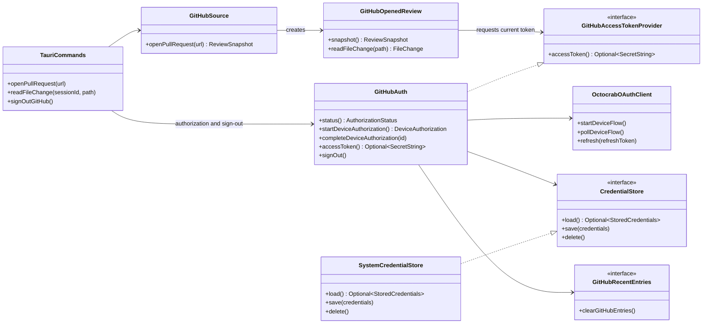

# Octocrab-backed GitHub Authentication

## Problem Statement

Narrant can authorize one GitHub account and open private Pull Requests, but its
authentication module directly implements Device Flow HTTP, response decoding, polling,
refresh-token rotation, operating-system credential storage, concurrency, and sign-out
policy in one large module. This makes protocol details harder to audit and change, while
the application assembly layer must currently fetch and pass tokens between GitHub
Authentication and the GitHub Source.

Reviewers should experience public and private Pull Requests as the same kind of
GitHub-hosted Change Comparison. Authentication is an optional access capability, not a
second Pull Request implementation.

## Solution

Use Octocrab as the HTTP boundary for Device Flow and refresh requests while retaining
Narrant's security and lifecycle policies. Split GitHub Authentication into a small
orchestrator, an Octocrab OAuth client, and an operating-system credential adapter.

The GitHub Source obtains an optional current access token through a narrow provider
interface. Anonymous access returns no token; authenticated access returns a secret token
and refreshes it when required. Tauri commands no longer receive, inspect, or pass token
values. Public and private Pull Requests continue through the same GitHub Source,
Review Snapshot, and File Change behavior.

## User Stories

1. As a reviewer of public code, I want anonymous Pull Request review to remain available, so that authentication stays optional.
2. As a reviewer of private code, I want the same Pull Request experience after authorization, so that privacy does not create a second review workflow.
3. As a reviewer, I want Device Flow protocol behavior delegated to a maintained GitHub client, so that authorization follows current GitHub behavior.
4. As a reviewer, I want token refresh requests to use the same authentication HTTP boundary, so that authorization traffic has one auditable path.
5. As a security-conscious reviewer, I want access and refresh tokens represented as secret values inside Rust, so that debug output cannot expose them accidentally.
6. As a security-conscious reviewer, I want tokens kept out of Tauri command arguments and responses, so that the WebView never handles credentials.
7. As a reviewer, I want access tokens refreshed before expiry, so that long-running Review Sessions continue loading File Changes.
8. As a reviewer, I want concurrent reads to share one refresh operation, so that rotating refresh tokens cannot invalidate one another.
9. As a reviewer, I want refresh-token rotation persisted atomically, so that an obsolete token cannot overwrite newer credentials.
10. As a reviewer, I want failed or expired refresh credentials removed, so that the application asks me to authorize again instead of repeatedly retrying invalid state.
11. As a reviewer sharing an operating-system account, I want sign-out to remove credentials and GitHub-specific review state, so that another GitHub account cannot see private locations.
12. As a local reviewer, I want sign-out to preserve Local Branch Comparison sessions, so that GitHub account changes do not disrupt local review.
13. As a maintainer, I want system credential behavior isolated from OAuth protocol behavior, so that platform storage changes do not alter authorization logic.
14. As a maintainer, I want GitHub Authentication exposed through one narrow interface, so that application assembly does not coordinate credentials.
15. As a maintainer, I want existing Pull Request and File Change contract tests preserved, so that the refactor cannot change observable review behavior.
16. As a maintainer, I want blocking GitHub Source reads kept off the asynchronous runtime, so that the UI remains responsive during the transitional architecture.
17. As a maintainer, I want test endpoints available only to test builds, so that release credentials cannot be redirected by process environment.
18. As a maintainer, I want a separately tracked migration of all GitHub Source HTTP to Octocrab, so that this authentication refactor remains bounded.

## Implementation Decisions

- Octocrab owns Device Flow HTTP, polling cadence for authorization-pending and
  slow-down responses, successful OAuth response decoding, and refresh HTTP transport.
- Narrant owns single-account policy, credential persistence, expiry decisions,
  refresh-token rotation, concurrency deduplication, terminal-error translation,
  sign-out, and Review Session cleanup.
- GitHub Authentication is a deep module with one public orchestration interface and two
  private adapters: an Octocrab OAuth client and a system credential store.
- The operating-system credential adapter uses Keychain on macOS and Credential Manager
  on Windows. Token values and expiry metadata are never stored in application JSON.
- Access and refresh tokens use secret wrapper types throughout Rust. Plain secret text
  is exposed only at the Octocrab request boundary and credential serialization boundary.
- A narrow asynchronous access-token provider returns either no token for anonymous
  access or a current secret token for authenticated access.
- The GitHub Source depends on the provider capability rather than the concrete
  authentication service.
- Every asynchronous GitHub Source operation obtains the current token through the provider.
  A Review Session does not permanently copy the token that existed when it opened; the
  transitional blocking adapter reuses that operation token for its internal HTTP calls.
- Public and private Pull Requests use one GitHub Source and identical Review Snapshot
  and File Change models.
- Tauri commands orchestrate Review Sessions only; they do not fetch, inspect, serialize,
  or pass access tokens.
- GitHub Source entry points become asynchronous at the caller boundary. Existing
  blocking Change Content HTTP temporarily runs on blocking workers rather than nesting
  an async runtime inside synchronous code.
- Test-only endpoint substitution remains unavailable in production builds.
- ADR 0001 and ADR 0002 are updated to record the authentication/provider relationship
  and Octocrab boundary. The domain glossary is unchanged because these are
  implementation decisions, not new domain concepts.

### Class diagram

## Testing Decisions

- Tests verify observable behavior through GitHub Authentication, GitHub Source, and
  Tauri command seams. They do not test Octocrab internals.
- The primary authentication seam covers Device Flow, token persistence, refresh
  rotation, concurrent refresh deduplication, invalid credentials, and sign-out.
- The primary review seam is the existing opened-review and Review Session contract. It
  verifies that anonymous and authenticated Pull Requests produce the same public models.
- Pure private logic may receive focused unit tests for expiry calculations, state
  transitions, and error mapping where this improves meaningful line and branch coverage.
- OAuth and GitHub traffic use deterministic local mock servers. Automated tests never
  access a real GitHub account.
- Credential tests use in-memory adapters and verify that secrets cross only the
  credential boundary.
- Tests verify that File Change reads request a newly refreshed token rather than a token
  copied when the Review Session opened.
- Tests verify that concurrent reads trigger one refresh and persist the rotated token
  pair once.
- Tests verify Device Flow pending, slow-down, denial, expiry, disabled-flow, malformed
  response, and success behavior.
- Tests verify permission failures for Pull Request metadata and on-demand File Change
  content.
- Tests verify that sign-out closes GitHub Review Sessions and invokes GitHub recent-entry
  cleanup while preserving Local Branch Comparison sessions.
- Existing GitHub Pull Request, GitHub File Change, Local Branch Comparison, React
  component, and Review Session tests are retained as regression coverage.
- Rust and frontend coverage reports are generated and uncovered branches are inspected;
  no arbitrary percentage threshold is introduced.
- Rust formatting, Clippy, complete Rust tests, ESLint, TypeScript build, and complete
  frontend tests remain required.

## Out of Scope

- Migrating Pull Request metadata, compare, pagination, commit, tree, or blob requests to
  Octocrab.
- Replacing the complete GitHub Source transport or its response models.
- Changing Review Snapshot or File Change frontend contracts.
- Changing GitHub App permissions, Device Flow selection, or the single-account policy.
- Adding a backend service, client secret, private key, Authorization Code, or PKCE flow.
- Implementing the persisted recent-entry store owned by its separate backlog item.
- Changing Local Branch Comparison behavior.
- Completing real personal-account installation or organization-approval validation on
  behalf of the maintainer.

## Further Notes

- Octocrab is a third-party Rust GitHub client listed by GitHub, not an official GitHub
  SDK.
- Octocrab does not own Narrant's refresh-token rotation policy merely because it sends
  the refresh request.
- A follow-up implementation issue must cover migrating all GitHub Source HTTP interaction
  to Octocrab and removing the transitional blocking worker.
- Issue #5 must remain open until the maintainer records successful real-account and
  organization-installation validation.
