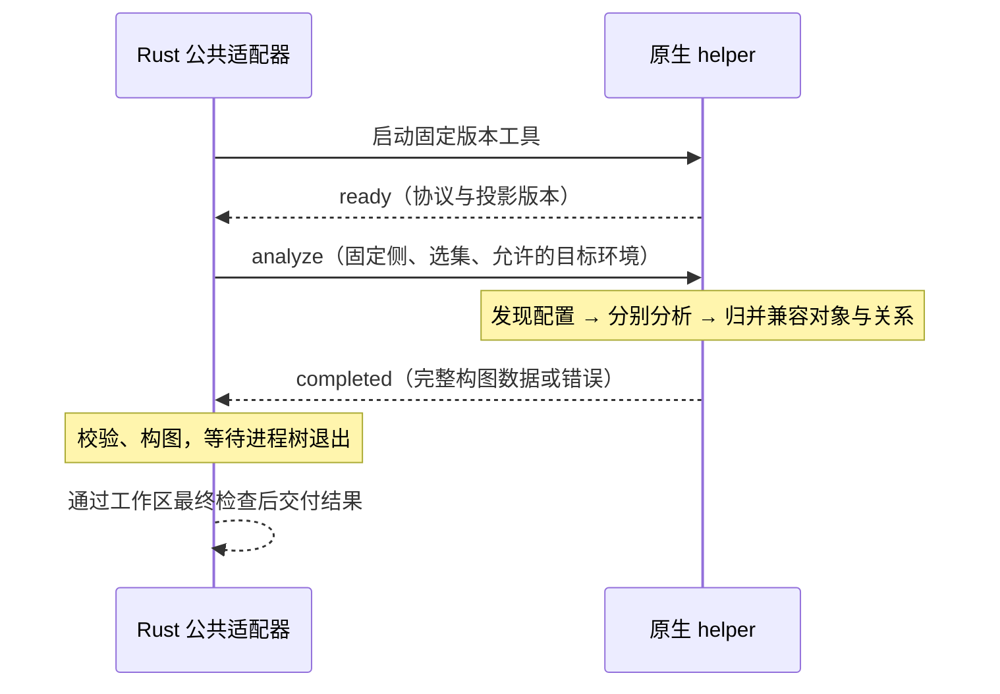

# 原生语言分析辅助进程：公共协议与验收

状态：已实现并完成新增原生链路的限定双平台验收，2026-10-03。
公共 Rust Host、四种 helper、应用接入、真实安装与 CodeGraph/diff 在 macOS ARM64 和 Windows x64 通过。
共享 WindowsJob 已修复并统一接入；`83d5642` 的生产路径完整双平台矩阵四组全部通过。
精确范围与旧缺陷见[跨平台记录](../research/native-crossplatform-validation.md)和
[实施计划](0024b-native-analyzer-implementation-plan.md)，不承诺未测 SDK，也不表示支持包已发布。
语言配置、映射和发布门槛见 [0024a](0024a-native-language-analysis-profiles.md)。

## 问题、范围与依赖

Java、Go、C#、C/C++ 使用各自原生分析 API，通过统一辅助进程接口生成 Code Graph。
Rust 不再为这些语言另写一套 AST 到图的映射，也不强制追加 LSP 阶段。
现有 Rust、TS/JS、Python 分析器不迁移；调用方仍得到 `Result<CodeGraph, AnalysisError>`。

本规格承接 [ADR-0034](../adr/0034-use-native-analyzer-helpers-for-new-languages.md)、
[公共图契约](0018-structure-review-code-graph.md)、[关系契约](0018b-code-relationships.md)、
[工作区所有权](../adr/0031-reuse-review-head-for-structure-analysis.md) 与
[支持包/项目工具链分离](../adr/0032-separate-language-support-packs-from-project-toolchains.md)。
它定义进程边界，不定义统一编译器 AST，不承诺任意项目、目标 SDK 或配置的支持。

## 职责与一次分析

| 部分 | 职责 |
| --- | --- |
| 调用方 | 固定比较侧、取得工作区保护、分派选集、使前后侧使用一致分析约定 |
| Rust 公共适配器 | 校验输入和工具来源、创建 scratch、启动/回收进程、收发协议、验证 DTO、构造 CodeGraph |
| 语言 helper | 静态发现配置、只读加载、原生语法/语义分析、源码身份和自身内容投影、归并、最终目标分类 |
| 语言支持包 | 提供固定版本 helper 及其运行依赖；项目目标标准库/SDK 按验证过的 profile 提供 |

首版每个 helper 进程只处理**一种语言支持实现、一侧仓库、一次请求**；C/C++ 可以由同一个
实现按明确语言模式处理。该进程内部复用解析器、项目上下文及多个配置，不按文件重复启动。
两侧仍可按既有生命周期并行，禁止把两侧源码混入同一语义环境。
先不做跨 Review 的常驻进程、并发请求复用、持久化图缓存或增量编辑协议。
这是以启动成本换取边界简单；若实测启动成为瓶颈，再优化会话复用。



## 传输和消息

建议 v1 使用 stdin/stdout 上的 UTF-8 NDJSON：一行一个 JSON 对象，字符串中的换行必须转义。
不是 LSP，也不开放 TCP 端口。stdout 只承载协议；stderr 只承载有界诊断，持续读取以免管道阻塞。
不把 stderr 输出视作可执行指令或成功证据。

- 每条消息必带 `protocol: "narrant.native-analyzer/1"` 和 `type`。
- 请求 ID 为非空字符串，终结响应和取消必须匹配。v1 不接受批请求及第二个 analyze。
- helper 恰好发送一次 ready；在有效 analyze 前不得发送 completed。
- 拒绝重复 JSON 键、未知消息类型、未知字段、错误类型和不支持的协议版本；扩展必须升级契约。
- 所有消息、诊断和结果受 Host 的有界读取约束。超过限制明确失败，不截断图后返回成功。
- 超时包含启动、分析及退出三个阶段；不得每收到日志便无限延长总分析期限。
- 大图先使用一个完整结果消息；解码时有界累积。若实际样本证明峰值内存不可接受，再引入
  分块传输与最终提交标记，不先设计流式部分图。具体字节数/超时是发布参数，需性能样本校准。

| 消息 | 方向 | 额外必需字段与含义 |
| --- | --- | --- |
| `ready` | helper → Host | `helper_id`、`helper_version`、`projection_revision`、`languages`、`profiles` |
| `analyze` | Host → helper | `id`、`input`、`environment`、`limits` |
| `cancel` | Host → helper | `id`；请求停止正在执行的分析 |
| `completed` | helper → Host | `id`、`outcome`；按下文互斥结果分支编码 |

`helper_version` 必须与所启动的已校验支持包匹配；`projection_revision` 标识该实现的身份、
内容规范化及关系规则版本。`languages` / `profiles` 为支持的非空字符串列表，不等于发布兼容矩阵。
前后侧必须冻结相同 helper、投影版本及配置发现政策；目标环境分别由本侧配置确定。
不能因某侧失败自动改用另一版本或另一引擎。

## Analyze 输入

`input`：

| 字段 | 类型 | 约定 |
| --- | --- | --- |
| `repository_root` | string | 本侧受生命周期保护的绝对目录；路径只用于访问，不进入源码身份 |
| `files` | string[] | 当前侧存在的、去重的仓库相对文件路径；空文件也保留 |
| `include_tests` | boolean | 对应当前 AnalysisOptions；两侧一致，默认 false |
| `profile` | string | 已校验的语言分析政策版本，规定配置发现、源码范围及映射，不是用户手选某个配置 |

`environment`：

| 字段 | 类型 | 约定 |
| --- | --- | --- |
| `scratch_root` | string | 本次分析专有的仓库外临时目录，只放缓存、日志、受控工具产物及控制元数据 |
| `platforms` | Platform[] | Host 预先校验的候选目标环境；helper 只能从中匹配本侧明确目标 |

Platform 字段固定为 `id`、`kind`、`version`、`root`、`fingerprint`、`metadata`。
`kind` 区分 JDK 平台声明、Go SDK、.NET 引用程序集或 Clang 目标环境；`root` 是经过来源校验的目录。
`metadata` 是按 kind/profile 明确定义、逐字段校验的描述对象，不是任意编译参数或执行命令入口。
同一目录不因进入 catalog 就自动授权读取其第三方插件、业务依赖和工具配置。
缺少匹配平台返回 `target_unavailable`，不偷偷使用 helper 自带运行时的标准库代替项目目标。
平台来源、具体 metadata 和支持版本由语言规格及固定包清单补全；此草案不授权自动安装项目 SDK。

`limits` 固定为正整数 `analysis_timeout_ms`、`max_result_bytes` 和 `max_diagnostic_bytes`。
Host 同时独立执行这些限制，不依赖 helper 自觉报告；启动和强制退出期限由 Host 管理。
线上数值必须根据验收样本确定；协议例子中的数值不作为性能承诺。

输入路径统一以 `/` 表达相对路径；拒绝绝对文件路径、`..`、NUL、重复或越界目标。
符号链接按解析后来源校验，不能借仓内链接读取仓外依赖；Windows 的盘符、UNC、大小写与链接
按真实文件系统处理，不能只做字符串前缀比较。不静默损坏无法通过协议往返的路径。

选集只决定图成员。helper 可以读取同侧其它允许的仓库源码和静态配置作为上下文，
但不把所有上下文对象加入图。每个请求文件必须产生覆盖说明；读失败或无法提取不是空文件。

## Completed 结果

只有以下三个互斥分支，不存在 `partial`：

- `outcome: "ok"`：必带 `graph`、`evidence`；不带 `error`。
- `outcome: "error"`：必带 `error`；不带 `graph` / `evidence`。
- `outcome: "cancelled"`：不带 `graph` / `evidence` / `error`，表示 helper 确认因取消终止。

`graph` 包含 `root_contains: string[]`、`nodes: Node[]` 和 `external_symbols: ExternalSymbol[]`。
虚拟根没有 ID、language 或源码。
这是构造 DTO，不能直接当作已验证的 Rust CodeGraph，也不是当前 WebView 的展示 DTO。

Node 所有字段均出现：

| 字段 | 类型 | 约定 |
| --- | --- | --- |
| `category` | enum | `container/type/callable/value/execution_region/extension`，唯一类别来源 |
| `id`、`language`、`native_kind` | string | 非空；身份带语言命名空间，具体编码由语言 profile 规定 |
| `name`、`signature`、`code`、`source` | string 或 null | 对应现有 CodeNodeData；null 不能掩盖提取失败 |
| `contains` | string[] | 直接子节点 ID；声明单父，不重复包含同一 ID |
| `references` | Reference[] | 只包括有约定的关系；重复事实去重 |
| `extensions` | object | 带命名空间的语言语义 JSON；参与 diff，不放配置诊断、时间戳和缓存信息 |

Reference 为 `{ "semantic": string, "target": Target }`；Target 恰好是以下之一：

```jsonl
{"kind":"node","id":"go:example/pkg#Run"}
{"kind":"external","symbol":"go:fmt#Println"}
{"kind":"unresolved","name":"missing.Call"}
```

以上 ID 只是展示字段的例子，不提前指定 Go 的最终身份编码。Node 表示已确定且属于最终图；
External 表示已确定但不在图中，可能仍是仓内未选源码；Unresolved 只保留观测名。
公共层不按同名、路径后缀或模糊匹配“补齐”关系。

ExternalSymbol 为 `{symbol: string, name: string, scope: "repository" | "dependency"}`。
每个最终 External 引用的 symbol 恰有一条描述，不接受重复/冲突、缺失或未被引用的描述。
name 是 helper 从已解析符号取得的可读名称；scope 按该符号的真实来源判定，不能靠 ID 拼写猜测。
本侧仓内未选声明及可证实的仓内隐式成员属于 repository；目标标准库属于 dependency。
该表映射到现有 `CodeGraph::with_external_symbols`，支持已有界面的名称与依赖过滤，
不参与图内容 diff，也不扩大业务依赖读取范围。没有 External 时仍输出空数组。

`evidence` 是仅供适配器验证/诊断的控制元数据，不存入 CodeGraph、不参与内容 diff、不要求新 UI：

- `configurations`：`{id, source_paths, platform_ids}` 数组。ID 仅本请求内有效；路径为实际读取的
  仓内静态配置路径；没有配置文件的受支持 standalone profile 可为空。它记录实际分析集合，
  不声称穷举所有可能配置，也不建立逐边配置归属。
- `files`：与 input.files 一一对应的 `{path, disposition, configuration_ids}`。
  disposition 为 `analyzed`、`excluded_test` 或 `inactive`。后两者须由 profile 的测试/构建条件
  证明；不能用 inactive 表示未找到项目或解析失败。配置 ID 必须存在于 configurations。
- `origins`：每个节点恰有一个 `{node_id, selected_paths}`，非空 selected_paths 必须是选集子集。
  它表示该节点由哪些选中文件支持；逻辑包/命名空间可有多个路径，源声明必须有真实出处。
  这是内部来源检查，不能虚构单一源码位置，也不扩展现有公开导航模型。

Host 检验 configurations.id 唯一，platform_ids 均来自输入 catalog；standalone 也有实际配置
记录，只是 source_paths 可以为空。analyzed 文件至少关联一个实际配置；excluded_test / inactive
保留用于判断排除的配置集合，不允许 origin 将它们用作已提取对象的来源。
origins 的 selected_paths 去重，并且只能引用 disposition 为 analyzed 的文件；所有节点和来源
记录一一对应。输入 platform catalog 也不得含重复 ID。

元数据的存在不能单独证明完整性；helper 的配置发现、来源判定和提取正确性仍须语言验收。
图为空也须完整覆盖 files，不能仅凭一段“成功”状态通过。

`error` 包含 `code: string`、`message: string`、`paths: string[]`；
paths 使用仓库相对路径，列表可为空。message 说明失败的目标/条件及原因，不发送只有在成功
evidence 中才能解释的配置 ID。初始错误代码：

| code | 含义 |
| --- | --- |
| `invalid_input` | 选集、环境或路径不合法 |
| `unsupported_configuration` | 发现会影响选集的配置，却无法按 profile 静态解释 |
| `target_unavailable` | 缺少兼容的目标 SDK/标准库声明 |
| `object_extraction_failed` | 不能保证支持对象完整，包括缺上下文使声明缺失 |
| `union_conflict` | 相同源码身份的内容/类别/声明位置不兼容 |
| `resource_limit` | 超时或有界资源限制 |
| `internal_failure` | 后端异常，无法归于受支持输入错误 |

协议错误、退出状态异常及公共构图失败由 Host 产生 AnalysisError，不冒充后端成功或取消。
只缺第三方绑定且对象可完整提取时正常返回图和 Unresolved；不是一律返回错误。

## 内部配置分析与归并

1. 静态发现 profile 能证明的配置集合，记录来源与目标。遇会影响选集却无法解释的配置失败；
   不启动 Maven/Gradle/MSBuild/CMake 等来求解，不枚举任意宏或标签。
2. 为各配置建立互相隔离的语义环境，完成受支持对象提取及关系证据收集。
3. 按源码身份归并，验证同一身份的 category、language、native_kind、name、signature、code、
   extensions 和声明父级兼容。source 是展示数据，按语言规则从固定侧原始源码确定。
4. 合并 contains/references 集合，按最终成员集将已确定目标分类为 Node 或 External。
   保留尚未解析的观测，不能用另一配置成功绑定掩盖它。
5. 检验全图单父、无包含环、根可达、图内引用端点存在，再输出。Host 仍独立重复公共校验。

不同源码位置的同名声明不是自动冲突，也不是自动同一对象；需要语言身份规则区分。
同一源码声明经宏或类型上下文得到不同编译类型，若原始自身内容与对象映射兼容，可合并其
已解析关系。若 category、身份对应或所属位置确实不兼容，则失败，不能按配置复制节点绕过。
原始源码投影本身也必须遵守去注释/格式、保留字面量和排除独立子对象内容的契约。

并集只表达“至少一种已分析配置下成立”。组合路径不保证在同一配置成立；配置名称和内部顺序
变化但最终事实未变时，不制造图差异。`CodeGraph::merge` 不是这里的配置归并器。

## 只读、工具与工作区生命周期

- helper 只能读本侧仓库源码/静态配置和已批准的目标平台声明；排除项目依赖下载及已有业务缓存。
  仓内 vendor 源码和安装目录由语言规则区别，不能简单按目录位置放行。
- 编译命令、项目配置、response file 只作为受限数据解析；不通过 shell 执行原命令。
  插件加载、注解处理、源码生成、隐式工具链下载以及被分析程序执行均被排除。
- 仓库原位读取；不复制源码、配置或声明到 scratch，不写后回滚，不用磁盘 overlay 绕过约束。
  内存文件宿主/别名可用；scratch 只放允许的工具产物。默认关闭或重定向仓内缓存。
- 进程环境按白名单构造，不继承会注入插件、依赖搜索路径、构建参数或工具链下载的宿主设置。
  SDK 发现与校验在明确入口完成，不能随 backend 的环境探测扩大输入范围。
- 只读保证不能仅靠“离线”“-mod=readonly”或工作区最后检查。任何会写入原目录的加载路径，
  在没有通过替代方案验收前不得发布；缺目标工具时明确失败。
- 不执行项目逻辑也不等于操作系统沙箱。实际隔离机制按平台验证，本规格不声称已有通用沙箱。

Windows 实现使用新增 native helper 专用 Job 所有者，保持既有 LSP/Python 进程管理行为不变。
新 helper 仍可创建后代；Host 在执行前建立 Job 与成员跟踪，清理时才禁止创建新成员。
成功判据要求持续持有的唯一进程对象全部退出，并与最终累计成员数相符；无法证明完整性时明确失败，
不能仅凭 Job 活跃数或当前成员列表为空宣称回收成功。专用产品接入已通过真实 Windows
探针、Host、安装与图验收；平台异常导致清理失败时不能将错误解释为全员已经退出。
旧 LSP/Python 共享 owner 的完成次序缺陷仍保留在跨平台记录，本轮未修改其行为。

状态顺序为 `starting → ready → running → terminal → reaped`。helper 启动初始化失败时尚无请求
ID，可以只输出 stderr 后非零退出；Host 将其映射为启动失败。ready 后必须等到一条有效 analyze
才能产生终结响应。Host 发出 analyze 后遇写入错误也进入清理，不能假定 helper 未开始工作。

helper 必须在发送并 flush 恰好一条 completed 后自行关闭协议输出、停止读取 stdin 并退出，不等待 Host
发额外 shutdown 或 stdin EOF。Host 收到终结消息后关闭 stdin、继续将 stdout/stderr 读到 EOF
并执行有界退出等待；额外协议消息属于错误。正常报告 error/cancelled 也应以 exit 0 结束，
非零退出或超时是异常退出信息，保留已观察到的真实分析失败，不以退出异常覆盖它。

收到 completed 仍是待验候选，
只有协议/来源/图校验通过、helper 及其后代退出、读写线程结束和工作区最终检查成功后才交付。
成功必须同时观察到完整终结消息、随后 EOF 及 exit 0；仅 EOF、仅 exit 0 或仅 completed 均不够。
输出错误后同样必须回收进程树；父 helper 退出不能视为后代已经退出。
终结前 stdin 意外 EOF 表示 Host 消失，helper 必须停止工作并清理；不能留下孤立后台分析。

取消时 Host 发 cancel，helper 应能在原生分析工作之外读取取消；超出退出宽限后由 Host 终止
整棵进程树并等待回收。Host 不因发送失败而跳过清理。后端不支持协作式取消时，强制终止仍须有效。
Host 仅在已记录取消原因时接受 outcome=cancelled；无取消请求却收到该结果属于协议失败。
真实失败优先于同时到来的取消；无既存失败且明确因用户/生命周期取消被终止时映射为 cancelled。
结果已经发出但尚未交付时发生取消，不能绕过工作区/调用方的有效性检查发布旧结果。
一侧失败会取消另一侧；所有工作都结束后才能释放保护，遵守 ADR-0031。

## 验收与交付顺序

| 编号 | 场景 | 必须证明 |
| --- | --- | --- |
| P1 | Unicode、转义换行、极小分片、多个消息连读 | 正确分帧；不混入 stdout 日志 |
| P2 | 重复键/字段、未知协议、错 ID、重复 ready、双终结、半行 EOF、异常退出、无请求的 cancelled | 硬失败；不返回空图或前一结果 |
| P3 | stderr 写满、结果超限、超时、后端不理取消、遗留子进程、Host 提前关 stdin | 无成功退出死锁；有界终止并回收进程树后才释放工作区 |
| G1 | 重复 ID、悬空 Node、双父、包含环、孤儿节点 | Host 拒绝；引用环仍合法 |
| G5 | 缺失/重复/多余图外符号描述，仓内未选目标及标准库 | 描述与 External 集合对应；名称/来源由后端给出，保留现有过滤能力 |
| G2 | 两配置同一调用分别解析到不同目标 | 两个有证据的目标进入并集 |
| G3 | 一配置已解析、一配置未知；局部 External 在最终并集入图 | 保留未知观测；只凭确定身份转成 Node |
| G4 | 同名不同源码、同源码不同父级/类别、配置顺序变化 | 身份不混淆；真实冲突失败；顺序不制造 diff |
| S1 | 未选上下文、测试排除、空/非活动文件、读失败 | 来源与覆盖可信；失败不伪装为空成功 |
| S3 | 重复配置 ID、未批准平台、origin 指向排除文件、漏文件覆盖 | 公共交叉校验拒绝不一致 evidence |
| S2 | body-only、仅格式注释、子对象正文、跨目录同一快照 | body 可比较；格式不变更；不污染父内容；身份不含 checkout 前缀 |
| B1 | 已有第三方缓存、恶意插件参数、自动生成器、仓外链接 | 不读被排除业务依赖、不执行项目逻辑、不越界 |
| B2 | 分析前后递归文件清单/字节比对，包含新增 untracked | 工作区保持只读；检查结果只是观测，仍需审计实际写入入口 |
| T1 | 两侧不同目标声明、缺 SDK、新宿主旧目标 | 正确使用本侧目标；不能把宿主新 API 当成旧项目可用 |

先以假 helper 验证公共协议、错误路径及生命周期，再接一门语言贯穿真实图/diff；其余后端复用
公共适配器和验收套件。公共适配器不引入另一份 Rust 语言映射。各语言必须补齐自己的目标矩阵、
身份/内容规则和真实项目 fixtures 后，才能宣称该语言支持完成。

Platform 的分语言 metadata 已在 [0024a](0024a-native-language-analysis-profiles.md) 固定，
首轮工具构件及摘要保存在 `resources/native-toolchains.json`，可调整的资源默认值见
[实施计划](0024b-native-analyzer-implementation-plan.md)。这些实施选择不等于发布兼容或性能承诺；
每个系统和目标版本仍须有真实运行证据，资源参数仍需结合工程样本校准。
若实验需要改变已批准的依赖/执行边界、图模型或完整性政策，必须重新提出具体取舍。
