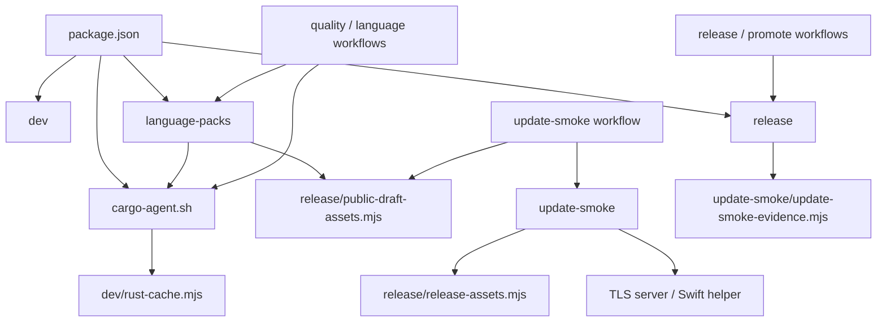

# 脚本目录组织

Status: Accepted — 用户于 2026-10-19 明确要求优先通过文件夹整理脚本，其次才考虑内部代码重构；
目录整理直接在 Issue #204、本聊天和同一个 PR 中实现，不另拆实施 Issue。

## 问题与范围

调查基线 `4a043d0e081e0f4c20941a65f7cc0b8dc57f47b0` 的 `scripts/` 顶层平铺 44 个生产文件、
6,185 行代码，另有 29 个 Node 测试文件。命令入口、可复用模块和平台资源混在一起，
维护者难以快速找到某条开发、构建、发布或验收流程的相关文件。

本次把 43 个文件迁入四个职责目录；`cargo-agent.sh` 保留既有位置。文件名和功能保留，
同步 package、workflow、模块引用、测试和现行文档。补充脚本导航，并修正现行发布说明的漂移。
目录名称是依据调查确定的可逆实现选择，不引入新的产品领域概念或架构决策。

不在本次增加通用任务框架、合并有不同退出行为的入口、删除活跃脚本或改变发布与验证流程。
内部重构候选列在本文，实际执行仍以目录整理为优先。

## 目录与入口

| 位置 | 生产文件数 | 职责与组织依据 |
| --- | ---: | --- |
| `scripts/cargo-agent.sh` | 1 | AGENTS、运维与所有 Cargo 调用共同指定的稳定入口。 |
| `scripts/dev/` | 4 | Tauri 启动、缓存、图标生成和人工模型 E2E，服务日常开发。 |
| `scripts/language-packs/` | 16 | 包构建、发布、SDK 准备与 Native Helper 验收使用同一语言选择和产物合同。 |
| `scripts/release/` | 12 | 应用版本、签名构建、资产、Draft、发布及可信 Actions run 检查。 |
| `scripts/update-smoke/` | 11 | normal/bootstrap 验收编排、系统适配、TLS 子进程、用户数据夹具与证据。 |
| `scripts/tests/` | 29 个测试 | 保留集中测试目录及现有 glob，避免搬迁时改变测试发现范围。 |

保持现有 pnpm 命令名、Cargo wrapper 路径、CLI 参数、环境变量、stdout/stderr、退出码及默认目录。
其余直接 `node scripts/<文件>` 调用改为分组后的路径；仓库内所有消费者和现行文档一起更新，
不为旧平铺位置再创建 43 个转发文件。仓库外若直接调用旧路径，需要按下方清单调整；
常用操作优先使用 [scripts 导航](../../scripts/README.md)中的 pnpm 入口。

`tests/` 已是独立目录；本次没有必要为了整理生产脚本同时改写测试 glob。新增测试继续放在该目录。
文件名包含 `migration` 的模块仍构建现行支持包，Windows 的两个入口仍有不同诊断和退出行为，
Python 窄入口也有现行文档和 workflow 使用方，均保留。

## 调用关系与模块边界

此图表达职责组之间的调用，组之间的双向引用不等于模块 import 循环。
`release-assets` 继续维护应用签名和八资产合同；`public-draft-assets` 的通用 GitHub asset 读取
同时被语言包发布使用。语言包的 prerelease 策略与应用 Latest 策略仍分别维护。
normal/bootstrap driver 与系统适配保持现有分工，Swift 和 TLS server 与调用方一起移动。
Native 包构建器仍由入口注入 `packageDirectory`，保留原有依赖方向。

具体运行链：

- `pnpm tauri` → `dev/run-tauri` → `dev/rust-cache`；Cargo → 根 wrapper → 同一缓存模块。
- 语言包 build → Native catalog、归档校验、各语言 recipe → helper build / TS smoke；verify →
  工具链与 Rust 前置条件 → Cargo、语言 helper、安装和 Review 验收。TS helper tests 直接复用 TS smoke。
- 应用 release → version-check → Notes → prepare-draft → reconcile；smoke → Draft receipt →
  previous assets → runner → driver → platform/TLS/user-data → evidence；promotion 再检查 run、资产和 evidence。

## 迁移风险与约束

1. 文件深度变化后，基于 `import.meta.url`、`SCRIPT_PATH` 或 `BASH_SOURCE` 的仓库根定位需要多退一层。
   以调用者 cwd 为目标的 release CLI 和产物参数保留原语义；不统一增加 `chdir`。
2. 除 import，还核对动态 import、workflow 内联 ESM、spawn、Cargo runner、Swift 源文件和 HTTPS server 路径。
   两个 shell 文件保留可执行位。
3. 保留 `GITHUB_ENV/GITHUB_OUTPUT` key、receipt/previous/evidence JSON 和 checksum 文件名、归档元数据及签名字节。
   Cargo target triple、updater target 与 Node platform/arch 三种平台标识继续区分。
4. [0017](0017-application-updates.md)、[0022](0022-language-support-packs.md)、
   [ADR-0036](../adr/0036-use-one-public-github-repository-for-distribution.md) 和
   [Rust 缓存约定](../agents/rust-build-cache.md)继续适用：单仓库分发、平台及签名门禁、hosted 正式验收、
   每 worktree 独立 target、仓库级 Cargo 锁及 incremental 均保留。
5. 历史 ADR、研究、计划及带时间的验收证据保留原始路径语境。现行操作说明更新为新路径。
   根 `RELEASE.md` 改为当前准备入口与正式发布运维导航；语言包文档同步 PR CI 的复用与不上传产物行为。

## 同一 PR 内的实施顺序与验证

1. **盘点与基线**：逐项核对 44 个生产文件、29 个脚本测试；运行原有脚本测试作为基线。
2. **按职责迁移**：依次整理 dev、语言包、release 和 update-smoke；同步全部引用与仓库根定位。
   最后核对旧路径只出现在明确保留的历史材料中。
3. **验证和文档**：运行 `pnpm test:scripts`，以及 release-prepare / file-type-icons-build 两项真实 CLI 回归；
   校验模块/子进程资源路径、shell 语法和文件权限。执行类型检查、Lint、生产构建和经 wrapper 的 Rust 检查。
4. **双平台与审核**：Windows 路径/进程专项使用既有语言包 workflow；同一 PR 的最新提交须通过自动
   `Complete CI`（含双平台 Rust、桌面 E2E 和全部 Native Helper）。Rust 全量由该提交 CI 覆盖时不在本地重复。
   不手动触发 quality-gate，不使用 skip ci。

本次没有 UI 行为改动；正式安装、签名、公证与升级仍按发布流程执行，普通 PR CI 不证明正式包升级通过。
回退时同时回退脚本与全部调用方的路径提交，不回退或更改运行时产物格式。

## 验收

- 44 个生产文件去向可核对，顶层只保留 Cargo 入口及导航；没有功能删除或重复实现。
- pnpm 命令与 Cargo wrapper 可继续使用，静态/动态 import、子进程、资源及现行文档的路径有效。
- 原有脚本测试数量和发现规则保持；实际 CLI、跨目录 TS helper 消费者与 workflow 顺序检查继续有效。
- 原有失败传播、清理、权限和签名/证据约束保留，本地聚焦验证和最新提交的完整 CI 提供证据。
- 规格、清单和导航随本次实现交付；本项不以只写方案或创建未来实施任务代替目录整理。

## 后续代码重构候选

这些候选均有源码依据，本次只记录评估结果，不自动新建 Issue：

| 候选 | 依据与取舍 |
| --- | --- |
| Windows 两个 process/lifecycle 入口共享实现 | Cargo argv 相同，但 Node 诊断、返回退出码与 AggregateError 不同；合并前需保留这些差异。 |
| 从 TLS adapter 独立有界命令执行 | `runBoundedCommand` 也被平台安装和签名调用；抽取时保留环境白名单、超时、输出限额和清理。 |
| 明确 Native packaging、recipe 与验收职责 | 当前构建同时产出归档、smoke 安装和验收配置；内部模块抽取可以保留行为，改变执行阶段则另定范围。 |
| 拆分通用 GitHub 传输与各发布策略 | 多个有界 reader 的上限、重定向、脱敏和认证规则不同；不能用最宽松实现覆盖所有调用。 |
| 调整 migration 命名 | 两个命名仍对应生产 catalog/helper build；可改名，不能据名字删除。 |
| release-prepare 的直接 Cargo metadata | 现有代码未经过统一 wrapper；修正需独立验证锁文件更新、目标 cwd 和失败回滚，未混入本次路径迁移。 |

## 完整脚本清单

下表列出迁移后的路径，文件 basename 与迁移前一致；原位置为 `scripts/<basename>`。
唯一例外是 Cargo 入口留在原位。测试仍位于 `scripts/tests/`，对应命名与现有行为断言保持。

| 脚本 | 职责 |
| --- | --- |
| [scripts/cargo-agent.sh](../../scripts/cargo-agent.sh) | 仓库级 Cargo 锁与缓存环境入口 |
| [scripts/dev/generate-file-type-icons.mjs](../../scripts/dev/generate-file-type-icons.mjs) | 生成 SVG 资产与文件图标 manifest |
| [scripts/dev/run-live-custom-provider-e2e.mjs](../../scripts/dev/run-live-custom-provider-e2e.mjs) | 人工真实模型 E2E 的配置与进程入口 |
| [scripts/dev/run-tauri.mjs](../../scripts/dev/run-tauri.mjs) | pnpm/Tauri 参数、签名公钥配置与进程退出 |
| [scripts/dev/rust-cache.mjs](../../scripts/dev/rust-cache.mjs) | sccache 环境、状态和受限缓存清理 |
| [scripts/language-packs/archive-validation.mjs](../../scripts/language-packs/archive-validation.mjs) | 归档条目、前缀和路径逃逸校验 |
| [scripts/language-packs/build-language-support-packs.mjs](../../scripts/language-packs/build-language-support-packs.mjs) | 支持包构建入口、通用归档及 TS recipe |
| [scripts/language-packs/build-migrating-native-helper.mjs](../../scripts/language-packs/build-migrating-native-helper.mjs) | Rust/Python helper 编译与 TS 协议文件暂存 |
| [scripts/language-packs/native-language-support-packs.mjs](../../scripts/language-packs/native-language-support-packs.mjs) | 原生语言 recipe、许可、smoke 与验收配置 |
| [scripts/language-packs/native-migration.mjs](../../scripts/language-packs/native-migration.mjs) | 七套现行 Native Helper 与工具链选择 |
| [scripts/language-packs/native-xz-extraction.mjs](../../scripts/language-packs/native-xz-extraction.mjs) | 有界 XZ/TAR 管道与 Windows 子进程回收 |
| [scripts/language-packs/prepare-rust-native-tests.mjs](../../scripts/language-packs/prepare-rust-native-tests.mjs) | 历史 Cargo 与项目工具链的测试前置检查 |
| [scripts/language-packs/provision-native-toolchains.mjs](../../scripts/language-packs/provision-native-toolchains.mjs) | 校验固定 SDK 下载、解包和环境输出 |
| [scripts/language-packs/publish-language-support-packs.mjs](../../scripts/language-packs/publish-language-support-packs.mjs) | 不可变语言 prerelease 发布与公开回读 |
| [scripts/language-packs/run-rust-helper-test.mjs](../../scripts/language-packs/run-rust-helper-test.mjs) | Cargo test runner 的项目工具链环境还原 |
| [scripts/language-packs/run-windows-lifecycle-tests.mjs](../../scripts/language-packs/run-windows-lifecycle-tests.mjs) | Windows 生产进程所有者聚合验收入口 |
| [scripts/language-packs/run-windows-process-probe.mjs](../../scripts/language-packs/run-windows-process-probe.mjs) | 带 Node 身份诊断的 Windows 进程验收入口 |
| [scripts/language-packs/select-msvc-redist.mjs](../../scripts/language-packs/select-msvc-redist.mjs) | 精确 MSVC runtime 与 DLL 版本选择 |
| [scripts/language-packs/typescript-native-smoke.mjs](../../scripts/language-packs/typescript-native-smoke.mjs) | TS helper 协议、图和退出生命周期 smoke |
| [scripts/language-packs/verify-native-analyzers.mjs](../../scripts/language-packs/verify-native-analyzers.mjs) | 语言包构建与 helper/Host/安装/Review 验收编排 |
| [scripts/language-packs/verify-python-analyzer.mjs](../../scripts/language-packs/verify-python-analyzer.mjs) | 委托共享 Native 验收的 Python 窄入口 |
| [scripts/release/build-macos-signed.sh](../../scripts/release/build-macos-signed.sh) | 本地 macOS 签名、公证与 DMG 校验 |
| [scripts/release/generate-public-release-notes.mjs](../../scripts/release/generate-public-release-notes.mjs) | 按稳定 tag 与 commit 主题生成 Release Notes |
| [scripts/release/prepare-draft-assets.mjs](../../scripts/release/prepare-draft-assets.mjs) | Draft 资产准备的 CLI 参数与环境入口 |
| [scripts/release/promote-stable-release.mjs](../../scripts/release/promote-stable-release.mjs) | 二次复核 Draft、前版与证据后发布 Latest |
| [scripts/release/public-draft-assets.mjs](../../scripts/release/public-draft-assets.mjs) | GitHub asset 下载、完整 Draft 校验与 receipt |
| [scripts/release/read-public-stable-identity.mjs](../../scripts/release/read-public-stable-identity.mjs) | 匿名读取当前 Stable tag 和 manifest 字节摘要 |
| [scripts/release/reconcile-draft-release.mjs](../../scripts/release/reconcile-draft-release.mjs) | 以固定 Release 身份创建或重建 Draft 资产 |
| [scripts/release/release-assets.mjs](../../scripts/release/release-assets.mjs) | 八资产合同、签名、信任策略与 manifest/checksum |
| [scripts/release/release-prepare.mjs](../../scripts/release/release-prepare.mjs) | 同步四处版本、创建提交和 tag、失败回滚 |
| [scripts/release/release-version-check.mjs](../../scripts/release/release-version-check.mjs) | 发布 tag 与版本声明一致性校验 |
| [scripts/release/release-version.mjs](../../scripts/release/release-version.mjs) | 四处版本读取、稳定版本规则与比较 |
| [scripts/release/verify-evidence-run.mjs](../../scripts/release/verify-evidence-run.mjs) | 可信 Actions run 与精确 artifact 身份校验 |
| [scripts/update-smoke/macos-close-narrant-window.swift](../../scripts/update-smoke/macos-close-narrant-window.swift) | 按 exact PID/bundle 检查窗口与正常退出 |
| [scripts/update-smoke/native-update-platform-adapter.mjs](../../scripts/update-smoke/native-update-platform-adapter.mjs) | 双平台正式安装、启动、恢复与清理适配 |
| [scripts/update-smoke/native-update-smoke-driver.mjs](../../scripts/update-smoke/native-update-smoke-driver.mjs) | normal/bootstrap 动作序列与 observation |
| [scripts/update-smoke/prepare-update-smoke-assets.mjs](../../scripts/update-smoke/prepare-update-smoke-assets.mjs) | 上一 Stable 下载、签名校验与 previous.json |
| [scripts/update-smoke/run-native-update-smoke.mjs](../../scripts/update-smoke/run-native-update-smoke.mjs) | 固定 driver 子进程、环境与 evidence 写入 |
| [scripts/update-smoke/update-smoke-environment.mjs](../../scripts/update-smoke/update-smoke-environment.mjs) | 升级验收子进程环境白名单 |
| [scripts/update-smoke/update-smoke-evidence.mjs](../../scripts/update-smoke/update-smoke-evidence.mjs) | 证据 schema、检查点、freshness、聚合与 checksum |
| [scripts/update-smoke/update-smoke-tls-gate-server.mjs](../../scripts/update-smoke/update-smoke-tls-gate-server.mjs) | 固定候选路由的临时 HTTPS 子进程 |
| [scripts/update-smoke/update-smoke-tls-gate.mjs](../../scripts/update-smoke/update-smoke-tls-gate.mjs) | 候选路由与 hosts/server/CA 资源恢复顺序 |
| [scripts/update-smoke/update-smoke-tls-system-adapter.mjs](../../scripts/update-smoke/update-smoke-tls-system-adapter.mjs) | 系统命令、CA、hosts、DNS 与 TLS server 控制 |
| [scripts/update-smoke/update-smoke-user-data.mjs](../../scripts/update-smoke/update-smoke-user-data.mjs) | 正式数据格式的项目/设置保留夹具 |
